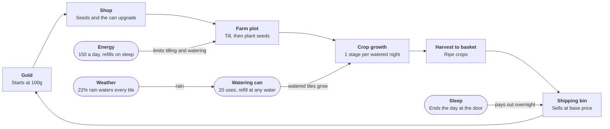

# Long Way Home — Game Design Doc

Nov 5, 2026 · @Chris Gaine

> This file is the living design doc and the source of truth. Edit it here; it replaces the earlier Claude Doc, whose last revision (rev 173) was merged in on 2026-11-07.

Long Way Home is a cozy 3D farming game (working title chosen 2026-11-05; the browser prototype is still called Little Acre, v0.1). This doc tracks how its systems connect, the numbers behind them, and what to build next. The title may change before release: three space-themed games on Steam already use "A Long Way Home" or "The Long Way Home", one of them with farming, so a subtitle or different name may be needed.

## Pillars

These are proposed starting points. Rewrite them until they feel right, then use them to settle feature debates.

1. **Relaxing, never punishing.** Mistakes cost a little time or energy, never the farm. Crops miss a day of growth instead of dying.
2. **Every day ends with a small win.** A harvest, a sale, an unlock or a new plant should land in each in-game day.
3. **Systems feed each other.** Every new feature must take from or give to an existing loop (gold, energy, time, items), not sit on its own.
4. **Readable at a glance.** Crop stage, watered state and what the Use button will do are always visible without menus.

## Systems map

Gold drives the loop; energy, water and sleep gate how fast it turns. Square boxes are the six-step core daily loop; rounded boxes are the four supporting systems.

Gold buys seeds, seeds become crops, and crops ship for gold. Energy and the watering can cap how much of the plot you can work each day, and nothing grows or sells until you sleep. When you add a system, add its box and arrows here first.

## Systems

Nine systems exist in v0.1. Each row says how it works today, what it feeds, and the biggest open question. Add a row when a new system is proposed; if you can't fill "Feeds into", check it against pillar 3.

| System | How it works in v0.1 | Feeds into | Open question |
| --- | --- | --- | --- |
| Time | Day runs 6:00 am to 2:00 am, about 12 real minutes per day (about 1.7 game minutes per real second). Pauses while a menu is open. | Lighting, sleep, crop growth | Does a 12-minute day feel right once there is more to do? |
| Sleep | Bed at the front door ends the day. Staying up past 2 am means passing out and waking with 50% energy. | Crop growth, shipping payout, weather roll, save | Should passing out cost gold too? |
| Energy | 150 per day. Every tool swing or pour costs 2 (tilling, watering, chopping, mining); planting and harvesting are free. Refills fully on sleep. | Limits tilling and watering per day | What restores energy mid-day (food)? |
| Farming | Till a tile, plant a seed, crop grows 1 stage per watered night, harvest when ripe. Harvested tile stays tilled. | Basket | Decided: crops already planted keep growing past a season change; you just can't plant out-of-season seeds. Tilled tiles stay tilled for now (no reverting to grass). |
| Watering | Can holds 20 at Basic (more with Rosk, Groth and Forgelight upgrades), one charge per tile, 2 energy per pour; refills at any water: the pond on the farm, the river or the lake. Watered state resets each night. | Crop growth | Decided: Groth waters 3 tiles in a row, Forgelight a 3 x 3 area, still one charge per tile. |
| Weather | 22% chance of rain each new day. Rain waters every tilled tile, including newly tilled ones. | Watering, lighting | Add storms or seasonal weather odds? |
| Inventory | Slot-based backpack, stacks up to 99 per slot; 12 slots to start, tools take slots. | Shipping | Decided: backpack upgrades at Maggie's store (24, then 36 slots); chests from store level 3 and Tom. |
| Shipping | Drop the whole basket into the bin. Items sell at their base price overnight. | Gold | Add quality tiers (normal, silver, gold) for higher prices? |
| Shop | Prototype only: a seed stall on the farm sold 3 seed types and a can upgrade. Decided: the stall is removed; seeds and tools come from the general store in town, open from day one, so there's a reason to go into town. | Seeds, can capacity | Opening hours? Seasonal stock? |
| Gathering (planned) | Not in v0.1. Axe on trees gives wood, pickaxe on rocks gives stone. Each swing costs energy, so gathering competes with farming for the day. Materials go into the backpack. | Rebuilds, carpenter (wood to planks), backpack upgrades | Decided: trees and rocks respawn every couple of days, including in the meadow, but never on tilled soil or within 2–3 tiles of it. |

Saving happens once a night in the player's browser, so a day can be replayed by reloading before bed.

## Data tables

These are the values hard-coded in the v0.1 prototype. Where later sections differ (Seasons and crops, starting tools), the later sections win. When the game moves to a real engine, each table becomes a JSON file the game loads, with the ID column as the key other tables reference.

### Crops

| ID | Name | Grow time (days) | Seed cost (g) | Sell price (g) | Season | Regrows |
| --- | --- | --- | --- | --- | --- | --- |
| emberroot | Emberroot | 3 | 15 | 35 | Spring | No |
| dusktuber | Dusktuber | 5 | 30 | 75 | Spring | No |
| moonmelon | Moonmelon | 8 | 60 | 190 | Fall | No |

Name mapping: the v0.1 browser prototype and any earlier notes use Earth crop names. They map to the native crops as follows.

| Prototype ID | New ID | Season |
| --- | --- | --- |
| carrot | emberroot | Spring |
| potato | dusktuber | Spring |
| pumpkin | moonmelon | Fall |
| tomato (planned) | sunbell | Summer |
| corn (planned) | starcorn | Summer |
| squash (planned) | coilsquash | Fall |

### Tools and upgrades

| ID | Name | Energy per use | Capacity | Cost (g) | Unlocks |
| --- | --- | --- | --- | --- | --- |
| hoe | Hoe | 2 | — | Starting tool | Tilled tile |
| can | Watering can | 2 | 20 | Starting tool | Watered tile |
| axe | Axe | 2 | — | Bought from Maggie, 50 (draft) | Wood from trees |
| pickaxe | Pickaxe | 2 | — | Bought from Maggie, 75 (draft) | Stone from rocks |

### Tool upgrade levels (draft)

Each tool (hoe, watering can, axe, pickaxe) upgrades through the same levels at Mira's blacksmith. Upgrade costs to be decided.

Metal names: the tiers are Basic, Rosk (copper tier), Groth (iron tier) and Forgelight (steel tier, Groth forged with Embrite). Where this doc says Copper, Iron or Steel, read Rosk, Groth or Forgelight.

| Level | Available from | Hoe | Watering can | Axe | Pickaxe |
| --- | --- | --- | --- | --- | --- |
| Basic | Start / Maggie's store | 1 tile | 20 uses, 1 tile | About 5 wood per tree | About 3 stone per rock |
| Copper | Blacksmith stage 1 | 3 tiles in a row | 40 uses | Fewer swings per tree | Fewer swings per rock |
| Iron | Blacksmith stage 2 | 3 x 3 area | 60 uses, 3 tiles in a row | Clears stumps; more wood | Breaks mine boulders; more stone |
| Steel | Blacksmith stage 3 | 5 x 5 area | 100 uses, 3 x 3 area | Large trees; most wood | Deepest mine rock; ship-part ore |

Energy rule (draft): every swing or pour costs 2 energy at every level. Upgrades do more per action instead: the Iron can waters 3 tiles and the Steel can 9 for the same 2 energy, and the axe and pickaxe need fewer swings (trees and rocks alike: Basic 4, Copper 3, Iron 2, Steel 1). Day length draft: about 12 real minutes (6 am to 2 am), 150 energy per day (raised from 120 so the first rebuild lands around day 5–6). Watering uses one charge per tile, so a 3-tile pour uses 3 and a 3 x 3 pour uses 9; the bigger area saves time and energy, not water.

### Locations

| ID | Name | Interaction | Range (tiles) |
| --- | --- | --- | --- |
| farm | Farm plot | Till, plant, water, harvest | 12 x 9 grid |
| door | House door | Sleep | 1.25 |
| bin | Shipping bin | Ship basket | 1.7 |
| stall | Seed stall | Removed: replaced by the general store in town | 2.2 |
| pond | Pond | Refill can | 3.8 from centre |

### Tuning constants

| Constant | Value | Used by |
| --- | --- | --- |
| Starting gold | 100g | New game |
| Starting seeds | 10 emberroot, 5 dusktuber (from Maggie) | New game |
| Max energy | 150 | Energy |
| Pass-out energy | 50% | Sleep |
| Time rate | About 1.7 game min per real sec (12 real min per day) | Time |
| Day start / end | 6:00 am / 2:00 am | Time |
| Rain chance | 22% per day | Weather |
| Season length | 28 days | Calendar (display only) |
| Walk / run speed | 3.6 / 5.2 tiles per sec | Player |

## Economy check

Pumpkins earn the most on every measure, about 2.4x carrots per tile per day, so once a player can afford them there is no reason to plant anything else. Numbers below are per tile, on a tile that is already tilled.

| Crop | Profit per harvest (g) | Gold per tile per day | Upfront cost per tile (g) |
| --- | --- | --- | --- |
| Emberroot | 20 | 6.7 | 15 |
| Dusktuber | 45 | 9.0 | 30 |
| Moonmelon | 130 | 16.3 | 60 |

Each growing day costs 2 energy to water, so gold per energy is half the gold per tile per day.

Right now the only things holding pumpkins back are cash flow (100g starting gold buys 1 pumpkin seed) and the 8-day wait. Ways to give the cheaper crops a role:

- Carrots regrow after harvest, so they earn without replanting.
- Seasons: pumpkins only in Fall, so each season has its own best crop.
- Other uses for crops (cooking for energy, NPC requests) that ask for specific crops, not just gold.

Decided since: pumpkins grow only in fall (see Seasons and crops), and rebuilds will ask for specific crops and materials, so every crop has a use.

## Long-term vision

You restore Ember Bay, an emptied lakeside town. At the start only one or two buildings and families remain. You rebuild buildings yourself with wood, stone and gold, and each rebuild brings a resident back, who unlocks new goods, tools or areas. Later buildings need materials that only earlier ones unlock, so the town and world open up over time.

- Starting tool: the hoe only. The axe (wood) and pickaxe (stone) are bought from Maggie's corner of the general store, before it's rebuilt, since the rebuild itself needs wood and stone
- No seed stall on the farm: the general store is open from the start (Maggie running it in its run-down state), so the player has a reason to head into town from day one. Its rebuild stages expand it from there
- Target platforms: Windows and Linux, including Steam Deck
- Engine: Godot 4 (.NET build) with C#. No mobile or iPhone build planned
- Controls: keyboard and mouse plus a controller, routed through Godot's input map so every action works on both

## Backstory

A space traveller crash-lands on a planet of a humanoid species, near the emptied town. His goal is to restore his ship and return to space. Along the way he meets the townspeople, builds a life, and rebuilds the town with the same resources he gathers for the ship. The ending is left open for now.

Alien flavour: a bit more than a light touch. Ember Bay should feel cozy and familiar but clearly not Earth. Ideas: native plants that glow or grow oddly, a few local crops and fish alongside familiar ones, humanoid townsfolk with small differences, and an alien night sky (e.g. two moons).

Why Ember Bay emptied: years ago a dam raised the lake. It drowned the lower town and flooded the deep levels of the mine. With the mine gone, the work dried up and families left.

The flooded mine is the main progression gate. To go deeper, you shore up each flooded level (sealing or pumping it, with parts from Mira and Tom). Once a level is shored up it stays open for good; the next level down needs its own work.

Shoring up a level can require any one or a combination of the following, varied per level. The mix is picked during design and then fixed, so every playthrough has the same requirements:

- Materials: planks from Tom for supports, and stone to pack the walls
- Metal parts: a pump or seal forged by Mira from ore found on the level above
- Tool tier: a pickaxe strong enough to clear the debris

Opening (draft): after the crash, he stumbles into town and meets Maggie. She is the only one who knows where he really came from, and she shows him to an abandoned farmhouse in the meadow, which becomes his farm. She acts as the tutorial: shows how to use the hoe and watering can, gives starter seeds (draft: 10 emberroot, 5 dusktuber for spring), and points him to her store for the axe and pickaxe once he has earned some gold.

Start (draft): 100 gold and a cleared 6 x 6 plot; the rest of the meadow is overgrown with trees, stumps and rocks. Clearing it both expands the farm and gives the first wood and stone. Expected first week: plant Maggie's seeds and buy the axe on day 1, sell carrots on day 4 (about 400 gold), buy the pickaxe on day 5, rebuild the store to level 2 around day 5–6.

Pattern: every fifth level needs a pump forged by Mira. The levels in between need debris cleared with the pickaxe and the flooding blocked with supports (planks and stone).

Depth: about 60 levels to start, so 12 pump levels (every fifth level).

Early mine, levels 1–5 (draft):

Access: the mine opens early, when you buy the pickaxe: Maggie mentions the old mine and the boards over the entrance come down. You can explore and get used to it early, but the flooding soon blocks you, a clue that something is wrong and a goal to work toward.

Maggie's mine story (draft, told when you buy the pickaxe): the mine was the heart of Ember Bay and half the town worked there. When the dam went in, water rose through the deep tunnels almost overnight. Clyde helped pull the last miners out. Mira's father, Harlan, spent years forging pumps to drain it, but none held, and folks drifted away. Nobody has been down in years, and old-timers spoke of lights in the deep levels that weren't lanterns.

- Resources: rocks for stone, copper ore for Mira's first tool upgrades, glimmercaps, the odd relic
- Each level: clear debris with the pickaxe, then shore up the walls with planks and stone
- Travel: a staircase built into the mine connects the levels; every fifth cleared level adds a shortcut from the entrance
- No danger in this version, only energy cost; danger (creatures, collapses) is a future enhancement
- Level 5: the first flooded level, drained with Mira's first pump, so the deeper mine is gated behind the blacksmith

Ore and tool upgrades: tool upgrades are earned by collecting materials in the mine.

| Where | What you get | Used for |
| --- | --- | --- |
| Rocks outside the mine | Stone only | Rebuilds, shoring |
| Mine levels 1–15 | Rosk ore | Rosk tools |
| Mine levels 15–30 | Groth ore | Groth tools |
| Deeper levels | Embrite, a rare native glowing mineral | Mira forges it with Groth into Forgelight, for Forgelight tools |

Early Groth: a few small Groth deposits appear on levels 3–5, so Groth tool upgrades are possible in Phase 2 before the main Groth levels (15–30).

Pumps (draft): Mira forges each pump overnight from materials you bring. Rosk pumps (Rosk ore plus Tom's planks) for levels 5–15, available from blacksmith stage 1; Groth pumps for levels 20–30; Forgelight pumps for level 35 and deeper. Each pump needs metal from the levels just above it. First pump (level 5), draft: 20 Rosk ore, 30 planks, 500 gold; later prices set in playtesting.

Pacing: no hard gate on how fast you go down; the mine is free to explore at any pace, as in Stardew. The cost is the brake: every level needs wood supports to shore it up, and pumps (every fifth level) are expensive, getting much more so deeper down, so reaching the bottom takes real time and resources. No company or faction choice.

Shoring (draft): levels 1–4 are above the water and only need debris cleared with the pickaxe. Level 5 is the first flooded level and needs the first pump. From level 6 on, each level is shored up with sealed planks: planks treated with sap from native trees, which glows and hardens waterproof. Sap comes from chopping trees, so going deeper also means more time in the forest. Sealed planks per level:

| Levels | Sealed planks per level |
| --- | --- |
| 6–15 | 10 |
| 16–30 | 20 |
| 31–45 | 30 |
| 46–60 | 40 |

The key ship parts lie in the mine, and each milestone deeper down gets him one step closer. The parts below are a first pass:

| Mine depth | Ship part (draft) |
| --- | --- |
| Level 15 | Power cell |
| Level 30 | Navigation crystal |
| Level 45 | Hull alloy |
| Level 60 (bottom) | Engine core |

Idea to explore: some parts need the town to finish them, e.g. the blacksmith forges the alloy into plating, Tom builds a launch frame.

Crash site (draft): fairly remote, in the forest at the base of the mountains near the mine entrance, hidden from town. The hull is half-buried with the power out. Inside are four empty slots for the power cell, navigation crystal, hull alloy and engine core; each installed part lights up a section of the ship, so progress is visible. Only Maggie knows at first; Mira and others learn through their lantern stories.

## First building: General store

The general store is the first building to restore. It is open from day one at level 1 (Maggie's corner) and grows through three rebuilds, each costing more wood, stone and gold.

| Stage | Unlocks |
| --- | --- |
| 1. Maggie's corner | Open from day one: starter seeds, axe and pickaxe |
| 2. Reopened | Basic seeds, first backpack upgrade |
| 3. Storeroom | More seed types, bigger backpack, chests for the farm |
| 4. Expanded shop | Maggie gives you a shipping bin for the farm; wider range of seeds and farm supplies |

Store rebuild costs (draft): level 2 is 50 wood, 25 stone, 300 gold and needs no Tom. Level 3 (storeroom): 40 planks, 60 stone, 1,200 gold. Level 4 (expanded shop): 80 planks, 120 stone, 20 Rosk ore, 3,000 gold. Levels 3 and 4 need Tom's planks, so they come after the carpenter reopens.

Selling: until store level 4 you carry crops to the store and sell them to Maggie. At level 4 she gives you a shipping bin for the farm, which sells overnight. (Early playtest builds can keep the bin from the start.)

Backpack (draft): slot-based; each slot holds a stack of one item, up to 99. Start with 12 slots, with the four tools taking slots (8 left for seeds, crops and materials). Maggie's upgrades: 24 slots at store level 2, 36 at level 3. The hotbar is one 6-slot row of the backpack shown on screen; a key or controller button cycles which row is the hotbar. With a full backpack, extra items drop on the ground and stay until the next morning.

## Carpenter

| Stage | Unlocks |
| --- | --- |
| 1. Reopened | Turns wood into planks, and planks plus sap into sealed planks for the mine; sells fences and chests |
| 2. Workshop | Repairs the bridge to a new area; farmhouse upgrades |
| 3. Builder | Rebuilds homes so more families can move back |

Rebuilt homes are their own track: each one gives a family room to return, bringing a shop, a service or new requests.

Carpenter costs (draft): stage 1 is 100 wood, 50 stone, 600 gold (no planks, since Tom isn't open yet); stage 2 (workshop, bridge repair) is 60 planks, 80 stone, 10 Rosk ore, 1,500 gold. Tom's conversions (draft): a plank costs 2 wood + 5 gold; a sealed plank costs 1 plank + 1 sap + 10 gold. Drop off materials and they're ready the next morning. A mine level needing 10 sealed planks costs about 20 wood, 10 sap and 150 gold.

Homes start early, not at Builder stage: the Hollis family lives above the workshop, so they move in when it reopens. Mira needs a home, so rebuilding her house is the first home rebuild. Her house costs 30 planks, 40 stone and 800 gold (draft), so Tom must be open first. She returns once that house is repaired and you have explored mine levels 1–5; once she moves in, she asks you to rebuild the blacksmith.

### Returning households (draft, order to be decided)

| Household | How they return | What they bring |
| --- | --- | --- |
| Retired schoolteacher (name TBD) | Rebuild their home | Opens the museum for relics |
| Rancher family | Bridge repaired, then rebuild the ranch house | Animals, feed, and how to care for them |
| Lumen-reader Ottlie | Rebuild their home | A wise elder who knows the planet's glowing plants; healing comes from plants that glow in the dark, gathered at night |

Clyde's grown kids also return, possibly as a couple of separate families, a payoff for Clyde's lantern story. Three kids, three roles: a boatbuilder who rebuilds the ferry to the far shore; a diver or salvager who helps search the sunken town for relics; and a fish market owner who pays more for fish than the bin and sells bait and tackle.

Arrival order and triggers (draft):

| # | Who | Trigger |
| --- | --- | --- |
| 1 | Fish market kid | Clyde's 2nd lantern: he writes to his kid; you rebuild a house on the dock |
| 2 | Rancher family | Tom repairs the bridge, then you rebuild the ranch house |
| 3 | Ottlie | You reach the darker mine levels; Maggie mentions an old friend who knows the glowing plants |
| 4 | Diver kid | Clyde's 5th lantern plus Mira's diving helmet; the sunken town opens |
| 5 | Schoolteacher | You find your first relics; Maggie writes to an old friend |
| 6 | Boatbuilder kid | Late game, tied to the ferry (parked for now) |

Boats: Clyde's rowboat is mid-game, for fishing over the sunken town. The ferry to the far shore is a separate, late-game boat, parked for now.

## Blacksmith

| Stage | Unlocks |
| --- | --- |
| 1. Reopened | Tool upgrades for axe, pickaxe, hoe and watering can; forges Rosk pumps |
| 2. Forge | Smelts ore into Groth; Groth pumps for deeper levels |
| 3. Master smith | Best tools; metal parts (e.g. sprinklers) needed for later rebuilds |

## Seasons and crops

Each season starts with two crops; more seeds unlock as the general store expands. Crops are native to the planet, not Earth crops (draft names, may change).

| Season | Starting crops |
| --- | --- |
| Spring | Emberroot (orange root, warm to the touch), dusktuber (purple tuber that keeps all winter) |
| Summer | Sunbell (sun-coloured berries that hang upside down on a bush), starcorn (tall stalks, glittering kernels) |
| Fall | Moonmelon (pale gourd that glows faintly at night), coilsquash (spiral squash) |
| Winter | None outdoors: a season for mining, fishing and rebuilding |

A greenhouse, built at some point in the restoration, allows growing through winter.

## Glowing plants (draft)

- Wild native plants that glow and can be picked only at night
- Found on the forest path, the riverbank and in the mine; rarer kinds deeper down
- Picked by hand, no tool, giving a reason to stay out after dark
- Most are seasonal, with a few that grow all year; winter has a few extra, since nothing else grows outdoors then
- Before Ottlie arrives you can pick and sell them without knowing what they do; once she arrives she reads them and turns them into remedies (e.g. energy tonics, light for dark mine levels)
- Later, Ottlie teaches you to grow a few on the farm, in shade or at night

Starter set (placeholder names and effects):

| Plant | Season | Effect |
| --- | --- | --- |
| Dawnmoss | Spring | Restores a little energy |
| Firefrond | Summer | Lights up dark places |
| Ashpetal | Fall | Makes crops grow faster |
| Frostlantern | Winter | Restores energy |
| Snowwick | Winter | Rare; sells for a lot |
| Glimmercap | All year (forest and mine) | Common; good for selling |

## Café

A separate building, opened by the carpenter's partner once the carpenter family has moved back. The general store stays focused on seeds, crops and supplies; the café is where you buy food that restores energy.

- Turns farm ingredients (crops now; eggs and milk once the ranch opens) into meals and baked goods
- Exact stages and recipes to be decided

Menu (draft): you simply buy dishes. June's ingredients are assumed to come from crops shipped through the farm bin, so there is no separate crop trade with her.

Every season has one light and one hearty dish, so no season is better for food; the choice of dishes just changes.

| Season | Light dish (30 energy, 60 gold) | Hearty dish (60 energy, 120 gold) |
| --- | --- | --- |
| Spring | Emberroot soup | Dusktuber hash |
| Summer | Sunbell salad | Starcorn chowder |
| Fall | Coilsquash stew | Moonmelon pie |

Price rule: about 2 gold per energy restored. Bigger meals can come later as rewards (e.g. June's lanterns).

## Residents

| Who | When | Role |
| --- | --- | --- |
| Maggie | From the start | Elderly shopkeeper; keeps a corner of the general store open |
| Clyde | From the start | Old fisherman at the dock |
| Carpenter family | Carpenter stage 1 | Tom (carpenter), June (partner, later runs the café) and Jesse (teen who helps in the workshop) |
| Mira | Blacksmith stage 1 | Young blacksmith; the old smith's daughter, back to reopen her father's shop |

## Friendships (draft)

Each resident has a five-step friendship meter, raised by talking daily, giving gifts they like and finishing their requests. Idea to keep it distinct from Stardew: show it as lanterns lit in each resident's window, one per step, so the town visibly glows brighter as friendships grow (fits the name Ember Bay).

| Resident | 1 | 2 | 3 | 4 | 5 |
| --- | --- | --- | --- | --- | --- |
| Maggie | Small seed discount | Hints at next season's seeds | Her story: the town before the dam | Rare seed each season | Leaves you the store's old storeroom key (free chest space) |
| Clyde | Tips on where fish bite | Better bait | His story: the flooded lower town | Rowboat to fish the deep lake | Shows you a sunken building to dive or salvage |
| Tom | Cheaper planks | Faster rebuilds | His story: why the family left | Free farmhouse upgrade step | Builds a feature of your choice (porch, shed) |
| June | Free snack when you visit | First café recipe | Her story | Daily energy meal discount | Signature dish that fully restores energy |
| Jesse | Helps gather wood once a week | Tells you town rumours | Their story: stay or leave town | Helps in the mine on request | Becomes an apprentice who runs small errands |
| Mira | Cheaper tool upgrades | Faster upgrades | Her story: what happened to her father | Notices your ship is not from here | Forges a special part that helps the ship |

Every lantern step also unlocks a piece of story: something new about that resident's past or the history of Ember Bay, alongside the reward in the table.

### Lantern stories (draft)

One story beat per lantern. Maggie's and Clyde's final beats plant the mystery that something fell into the lake before.

| Resident | 1 | 2 | 3 | 4 | 5 |
| --- | --- | --- | --- | --- | --- |
| Maggie | Ran the store with her late husband for forty years; knows every family that shopped there | Before the dam, the lower main street held summer dances; its rooftops are visible from the dock | The town voted for the dam on a promise of jobs; she voted yes and never forgave herself | Stayed because the store was her husband's dream | Years ago she saw a light fall into the lake, just like your crash |
| Clyde | Knows every bite in the lake | Grew up on a farm now underwater; still fishes above it | Was in the mine when it flooded and helped get miners out; never went back underground | His wife and kids moved to the city; he stayed and lost touch | Shows you his family's sunken barn; has seen strange lights under the water |
| Tom | Learned carpentry from his father, who built half of Ember Bay | Built the old docks in the lower town, now underwater | Moved the family to the city for steady work and hated it | Coming back was June's idea; he feared it would fail again | Asks you to help finish restoring his father's house |
| June | Grew up in the city; fell for Ember Bay on first visit | Her café runs on her grandmother's handwritten recipes | Runs it to bring people together; she knew no one in the city | Worries Jesse will leave like everyone else | Asks you to help plan the town's first festival in years |
| Jesse | Bored; wishes they were back in the city | Secretly good at fine woodwork, better than Tom | Explores the old mine entrance against the rules | Found a strange metal shard in the mine | Decides whether to stay or leave; your friendship nudges it |
| Mira | Learned at her father's side, then apprenticed in the city; townsfolk still call it "her father's forge" | After the flood her father spent years forging pumps to drain the mine; none held | His hands grew too shaky to work; he lives in a city care home, and she came back to keep his forge alive | His journal describes a metal deep in the mine no forge could melt; she realizes your ship is made of it | Together you learn to forge it; she makes a ship part and keeps your secret |

## Ember Festival

June's fifth lantern starts the festival: she asks you to help revive the town's old late-summer celebration, where everyone floats lanterns on the lake at dusk.

The first festival is a project, like a rebuild:

- You: crops for June's food tables
- Tom: stalls and a stage
- Clyde: a fish fry, if you bring him a catch
- Mira: forged metal lanterns

After the first one it repeats every year on a fixed late-summer date. It grows with the town: each resident who moves back adds a stall or activity.

## Fishing (draft)

- Rod: Clyde gives you his old rod at his first lantern
- Catching: cast, wait for a nibble, then hold to reel while keeping line tension in a safe zone; too much tension snaps the line
- Fish vary by spot (dock, river mouth, over the sunken town), season, time of day and weather
- Uses: sell, cook at June's café, Clyde's requests, the festival fish fry

### The sunken town

The lower town stays underwater for good; the lake is never lowered.

- From the dock: rooftops visible underwater but out of reach
- Clyde's 4th lantern: his rowboat, to fish over the sunken town for rare fish
- Clyde's 5th lantern: his family's sunken barn; Mira forges a diving helmet so you can salvage relics of the old town (and possibly more of the strange metal)

Relics go to a museum. A returning resident (an old retired schoolteacher, name to be decided) moves back once their home is rebuilt and offers to build an Ember Bay museum. Each donated relic fills a display and unlocks a piece of the lower town's history.

## Restoration order

Upgrades interleave across buildings rather than finishing one building first. Tool upgrades come early because most other progress depends on them.

How a rebuild works: each building has a sign out front. You drop off the wood, stone and gold it needs, and once everything is in, the building is rebuilt overnight. This works before Tom arrives.

1. General store, level 2
2. Carpenter, stage 1
3. Mira's house (first home rebuild), then Blacksmith stage 1 (first tool upgrades): Mira moves back and asks you to rebuild the forge
4. General store, level 3
5. Carpenter, stage 2 (bridge opens)
6. Blacksmith, stage 2 (Groth smelting and pumps)
7. Third stages of each, with homes rebuilt in between

### First rebuild costs (draft)

The first rebuild should take a few in-game days; numbers will be tuned in playtesting.

| Rebuild | Wood | Stone | Gold | Target time |
| --- | --- | --- | --- | --- |
| General store, level 2 | 50 | 25 | 300 | 3–4 days |
| Carpenter, stage 1 | 100 | 50 | 600 | About a week |
| Blacksmith, stage 1 | 40 planks (Tom is open by then) | 100 | 900 | About a week and a half |
| Blacksmith, stage 2 (Groth smelting and pumps) | 80 planks, plus 30 Rosk ore | 150 | 2,500 | Set in playtesting |

Gathering (draft): trees along the forest path and farm edges give about 5 wood and 2 sap each; rocks in the meadow and along the riverbank give about 3 stone each. Each swing costs energy, and both respawn every couple of days. The axe (50g) and pickaxe (75g) are cheap so the first harvest or two pays for them.

## World layout

The setting is mountain and lake cabin country. From top to bottom:

| Area | What's there | How it opens |
| --- | --- | --- |
| Mountains | The old mine | Opens when you buy the pickaxe; flooded levels block progress until shored up or pumped |
| Meadow | Your farm, above town | Start |
| Forest path | Trees and foraging between farm and town | Start |
| Town | Town square with the general store, carpenter, blacksmith and empty houses | Start (mostly empty) |
| Lakeshore | Dock for fishing | Start or early |
| Across the river | Old ranch (empty at first: a new area with trees and rocks to gather); later the rancher family and native animals | Carpenter stage 2 rebuilds the bridge |
| Across the lake | Far shore, to be decided | Future ferry upgrade |

### The river (draft)

The river runs from the mountains to the lake, giving several fishing spots along the way.

| Stretch | What it's like | Fishing |
| --- | --- | --- |
| Source | Snowmelt waterfall high in the mountains, near the mine and crash site | Cold pool at the base: rare fish |
| Mountain creek | Fast, rocky creek through the forest | Small, quick fish |
| Meadow | Slows and widens along the edge of your farm; can refill the watering can here | Easy early spot |
| Town | Separates town from the ranch; the broken bridge crosses here | River fish |
| River mouth | Spreads into the lake | River and lake fish mix |

## Ranch and animals (draft)

- Unlock: Tom repairs the bridge, you rebuild the ranch house, and the rancher family returns. They sell animals, feed and buildings
- Animals are native creatures: puffhen (round fluffy bird, lays glowing eggs), mossback (slow gentle grazer, gives milk), woolhorn (shaggy goat-like animal with curly horns, gives wool)
- Getting them: Tom builds a coop (puffhens) and a barn (mossbacks, woolhorns) on your farm; you buy young animals from the ranchers
- Care: feed daily and let them graze; happy animals give better products
- Uses: sell, supply June's café, or use in later rebuilds
- Future enhancement: breeding and hatching eggs

## Art direction

The look of the game lives in [ART_DIRECTION.md](ART_DIRECTION.md). In short: stylised 3D, a step up from the low-poly prototype, cozy and readable and light enough for the Steam Deck; familiar at first glance, with a touch of alien. Glow is the main alien signature. Where this doc and the art direction differ on how things look, the art direction wins.

## Milestone 1: Godot rebuild

Milestone 1 rebuilds the v0.1 browser prototype in Godot for Windows and Linux. It is done when it plays the same as the browser version, with a controller, on both platforms. The town, story and new systems above come after this.

1. Setup: Godot 4 .NET build, a C# project with folders for scenes, scripts and data, in a Git repo
2. World: flat ground, the farm grid, house, shipping bin, stall and pond, from simple low-poly shapes
3. Player: character with a follow camera, moving with keyboard or controller through the input map
4. Farming: tiles you can till, plant, water and harvest; crop data loaded from a JSON file built from the Crops table
5. Day cycle: clock, energy, sleep, shipping payout and overnight growth
6. Interface: hotbar, clock, gold and a simple shop menu
7. Saving and builds: save to a file, export for Windows and Linux, and test on the Steam Deck

## Open questions and backlog

Answer these from playtesting. Tick a question once its answer is written into the Systems or Data tables above.

### Questions

- [x] Camera: decided 2026-11-06. Rotate and zoom: free 360° rotation around the farmer, zoom within limits that tilts towards top-down when zoomed out, and walking relative to the camera's facing (REQ-52, Phase 1B)
- [ ] Pace: does a 12-minute day feel rushed or relaxed?
- [ ] Long-term goal: money targets, house upgrades, relationships, or a story?
- [ ] Failure: should anything ever be lost (crops dying, gold on pass-out)?
- [x] Platform: decided. Godot, Windows and Linux (including Steam Deck); iPhone dropped

### Backlog ideas

- [ ] Chop trees and break rocks for wood and stone
- [ ] Crafting (chests, sprinklers, fences)
- [ ] Seasons that change crops, weather odds and the look of the map
- [ ] Town with NPCs, friendship and requests
- [ ] Animals (chickens, cows) as a second income loop
- [ ] Fishing at the pond
- [ ] Cooking crops into food that restores energy
