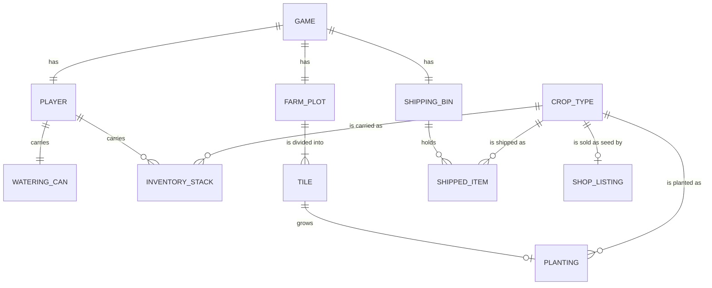
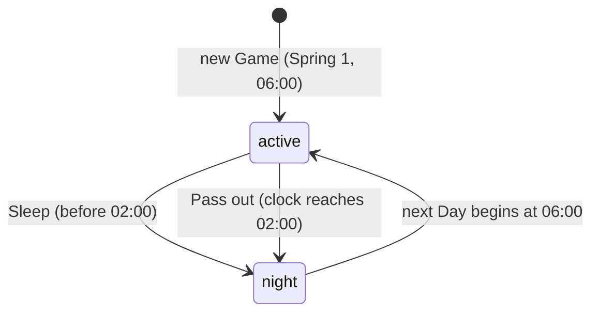
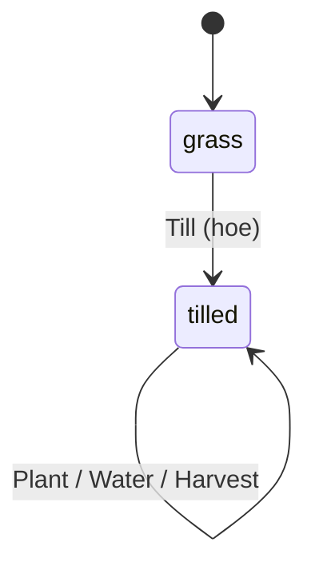
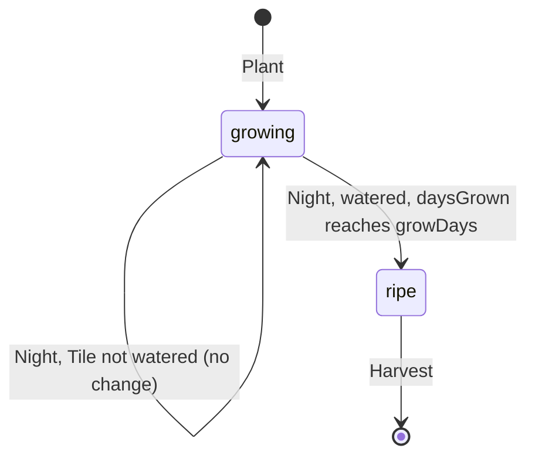

# Long Way Home — Domain Model

Single-context model of the game's rules, derived from [product-definition.md](product-definition.md) and the [requirements log](requirements-log.md). Enumerated values are listed in [canonical-values.md](canonical-values.md). Tuning numbers come from the [Game Design Doc](../GAME_DESIGN.md) data tables.

**Scope.** This version covers **Phase 1 — Godot rebuild** (REQ-1 to REQ-14). Later phases add their entities (backpack slots, buildings, residents, the mine and so on) through `requirements-intake` when each phase is readied. Nothing here is built yet; every rule applies to the Phase 1 Godot build.

## Ubiquitous Language

| Term | Definition |
|------|------------|
| **Game** | One saved playthrough: the calendar, the clock, the weather and everything the Player owns. A player can hold several Games (save slots). |
| **Player** | The stranded traveller the person controls. Has gold, energy, a watering can and an inventory. |
| **Day** | One in-game day, from 06:00 to 02:00 the next morning, lasting about 12 real minutes. |
| **Clock** | The time of day within the current Day, counted in game minutes since midnight. |
| **Season** | One of spring, summer, fall, winter. Each lasts 28 Days. |
| **Year** | Four Seasons. Year 1 begins on Spring 1. |
| **Night** | The step between two Days when crops grow, the Shipping Bin pays out, the weather is rolled and the Game saves. Not playable time. |
| **Sleep** | Ending the Day at the house door, before 02:00. |
| **Pass out** | Ending the Day by still being awake at 02:00. Costs half the next Day's energy and nothing else. |
| **Energy** | The Player's daily budget for tool actions. 150 at the start of a Day. |
| **Tool action** | One swing of the hoe or one pour of the watering can. Costs 2 energy. |
| **Farm plot** | The 12 x 9 grid of Tiles the Player farms. |
| **Tile** | One square of the Farm plot. Either grass or tilled. |
| **Till** | Turn a grass Tile into a tilled Tile with the hoe. |
| **Watered** | A tilled Tile that has been watered (or rained on) today. Resets each Night. |
| **Crop type** | A kind of crop, e.g. emberroot. Reference data: grow time, seed cost, sell price, season. |
| **Seed** | An inventory item that can be planted to start a Planting of its Crop type. |
| **Planting** | A crop growing on one Tile: its Crop type and how many days it has grown. |
| **Ripe** | A Planting that has grown its Crop type's full grow time and can be harvested. |
| **Harvest** | Pick a Ripe Planting. One crop goes into the inventory and the Tile stays tilled. |
| **Crop** | A harvested item of a Crop type, sellable through the Shipping Bin. |
| **Inventory** | What the Player carries: Seeds and Crops in stacks per Crop type, plus their tools. No size limit in Phase 1. |
| **Watering can** | The Player's can. Holds a number of charges; one charge waters one Tile. |
| **Charge** | One Tile's worth of water in the Watering can. |
| **Pond** | Where the Watering can is refilled. Refilling is free. |
| **Rain** | Weather on a Day that waters every tilled Tile for that whole Day. 22% chance each Day. |
| **Shipping Bin** | Where the Player drops all their Crops. Everything in it sells at base price during the Night. Final once dropped. |
| **Shop** | The menu where the Player buys Seeds for the current Season and the Watering can upgrade. |
| **Can upgrade** | A one-time purchase that raises the Watering can's capacity from 20 to 40. |
| **Gold** | The Player's money. Never negative. |

## Value Objects

| Value Object | Allowed values / shape | Used by |
|--------------|------------------------|---------|
| `Season` | `spring`, `summer`, `fall`, `winter` | Game, CropType |
| `Weather` | `clear`, `rain` | Game |
| `TileState` | `grass`, `tilled` | Tile |
| `PlantingStatus` (derived, never stored) | `growing`, `ripe` | Planting |
| `DayEndReason` | `slept`, `passed_out` | Game (last Night) |
| `ItemKind` | `seed`, `crop` | InventoryStack |
| `ToolId` | `hoe`, `watering_can` | Player tools |
| `ShopItemKind` | `seed`, `can_upgrade` | ShopListing |
| `CropTypeId` | `emberroot`, `dusktuber`, `moonmelon`, `sunbell`, `starcorn` | CropType, Planting, InventoryStack, ShippedItem, ShopListing |
| `GridPosition` | `{ x: 0–11, y: 0–8 }` | Tile |
| `GameDate` | `{ year: int ≥ 1, season: Season, day: 1–28 }` | Game |
| `ClockMinutes` | integer, 360 (06:00) to 1560 (02:00 next morning) | Game |
| `Gold` | integer ≥ 0 | Player, CropType, ShopListing |

## Entities & Aggregates

### CropType (reference data)

Loaded from the crop data table; read-only during play. The same for every Game.

| Attribute | Type | Notes |
|-----------|------|-------|
| `id` | CropTypeId | Key. Stable across saves and the prototype name mapping (carrot → emberroot, potato → dusktuber, pumpkin → moonmelon). |
| `name` | string | Display name, e.g. "Emberroot". |
| `growDays` | int | Watered Nights needed to become Ripe. emberroot 3, dusktuber 5, moonmelon 8, sunbell 4, starcorn 7. |
| `seedCost` | Gold | Shop price of one Seed. 15 / 30 / 60 / 20 / 45. |
| `sellPrice` | Gold | Shipping Bin price of one Crop. 35 / 75 / 190 / 50 / 130. |
| `season` | Season | The only Season the Seed can be planted or bought in. spring / spring / fall / summer / summer. |
| `regrows` | bool | `false` for every Phase 1 crop. Kept for later crops. |

Sunbell and starcorn (summer; draft numbers, tuned in playtesting) *(planned, REQ-42)*.

### ShopListing (reference data)

The items the Shop can offer. Read-only during play.

| Attribute | Type | Notes |
|-----------|------|-------|
| `id` | string | Key, e.g. `seed_emberroot`, `can_upgrade`. |
| `kind` | ShopItemKind | `seed` or `can_upgrade`. |
| `cropTypeId` | CropTypeId? | FK -> CropType.id. Required when `kind = seed`, otherwise empty. |
| `price` | Gold | For seeds, equals the CropType's `seedCost` (copied so the Shop has one price column). Can upgrade: price to be set in tuning. |

### Game (aggregate root)

One per save slot. Owns the calendar, the clock and the day's weather, and is the consistency boundary for everything below it.

| Attribute | Type | Notes |
|-----------|------|-------|
| `id` | uuid | Surrogate key; one per save slot. |
| `date` | GameDate | Starts at Year 1, Spring 1. |
| `clock` | ClockMinutes | Starts each Day at 360 (06:00). |
| `weather` | Weather | Rolled during the Night for the Day ahead; fixed for that Day. |
| `lastDayEnd` | DayEndReason? | How the previous Day ended. Empty on a new Game. Sets the morning's energy. |
| `createdAt` | instant | Real-world time the Game was started. |
| `savedAt` | instant | Real-world time of the last save (the last Night). |

#### Player (child of Game, exactly one)

| Attribute | Type | Notes |
|-----------|------|-------|
| `gameId` | uuid | FK -> Game.id. |
| `gold` | Gold | Starts at 100. |
| `energy` | int | 0–150. Starts at 150. |
| `tools` | set of ToolId | `hoe` and `watering_can` from the start. Tools are not inventory stacks. |

#### WateringCan (child of Player, exactly one)

| Attribute | Type | Notes |
|-----------|------|-------|
| `capacity` | int | 20, or 40 after the Can upgrade. |
| `charges` | int | 0 to `capacity`. Starts full. |
| `upgraded` | bool | `true` once the Can upgrade is bought. |

#### InventoryStack (child of Player, zero or more)

| Attribute | Type | Notes |
|-----------|------|-------|
| `kind` | ItemKind | `seed` or `crop`. |
| `cropTypeId` | CropTypeId | FK -> CropType.id. |
| `quantity` | int | ≥ 1. A stack at 0 is removed. |

Key: (`kind`, `cropTypeId`). New Game: `seed/emberroot × 10`, `seed/dusktuber × 5`.

#### FarmPlot (child of Game, exactly one)

| Attribute | Type | Notes |
|-----------|------|-------|
| `gameId` | uuid | FK -> Game.id. |
| `width` | int | 12. |
| `height` | int | 9. |

#### Tile (child of FarmPlot, exactly 108)

| Attribute | Type | Notes |
|-----------|------|-------|
| `position` | GridPosition | Key within the FarmPlot. |
| `state` | TileState | Starts `grass`. |
| `watered` | bool | True when watered or rained on today. Always false on grass. Reset each Night. |
| `planting` | Planting? | At most one. Only on a tilled Tile. |

#### Planting (child of Tile, zero or one)

| Attribute | Type | Notes |
|-----------|------|-------|
| `cropTypeId` | CropTypeId | FK -> CropType.id. |
| `plantedOn` | GameDate | Date it was planted. For display and tests only. |
| `daysGrown` | int | 0 to the CropType's `growDays`. Rises by one per watered Night. |
| `status` | PlantingStatus | **Derived, never stored**: `ripe` when `daysGrown = growDays`, otherwise `growing`. |

#### ShippingBin (child of Game, exactly one)

| Attribute | Type | Notes |
|-----------|------|-------|
| `gameId` | uuid | FK -> Game.id. |
| `items` | list of ShippedItem | Emptied every Night. |

ShippedItem: `cropTypeId` (CropTypeId, FK -> CropType.id), `quantity` (int ≥ 1).

## Relationships



## Lifecycle State Machines

### Day

States: `active` → `night` → `active` (next Day). `night` is not playable; it runs the Night steps below in a fixed order. Day phases are not stored; they are listed here for the transition rules.



| Transition | Actor | Rule |
|------------|-------|------|
| new Game → active | Player | BR-G1, BR-P6 |
| active → night (Sleep) | Player, at the house door | BR-G3 |
| active → night (Pass out) | Game, when the clock reaches 02:00 | BR-G3, BR-P4 |
| night → active | Game | Night steps in order: BR-T4 growth → BR-S2 payout → BR-G1 date advance → BR-G4 weather → BR-T7 watering reset → BR-P3 energy → BR-G5 save |

### Tile



A tilled Tile never returns to grass (BR-T8).

| Transition | Actor | Rule |
|------------|-------|------|
| grass → tilled | Player | BR-T2, BR-P2 |
| tilled: plant | Player | BR-T3, BR-C1 |
| tilled: water | Player | BR-W2, BR-P2, BR-T9 |
| tilled: harvest | Player | BR-T6 |

### Planting



| Transition | Actor | Rule |
|------------|-------|------|
| → growing | Player | BR-T3 |
| growing → growing / ripe | Game (Night) | BR-T4, BR-T5 |
| ripe → harvested | Player | BR-T6 |

## Business Rules

Abbreviations: **G** Game, **P** Player, **W** WateringCan, **T** FarmPlot and Tile, **C** CropType, **S** ShippingBin, **L** Shop (ShopListing).

### Game

- BR-G1: The date advances by one day each Night. After day 28 of a Season comes day 1 of the next Season (spring → summer → fall → winter → spring), and after winter the Year rises by one. A new Game starts on Year 1, Spring 1. (REQ-10)
- BR-G2: The clock runs from 06:00 to 02:00 at about 1.67 game minutes per real second, so a full Day takes about 12 real minutes. It advances only while play is running, never while a menu is open. (REQ-3)
- BR-G3: A Day ends exactly once: by Sleep at the house door before 02:00, or by Pass out when the clock reaches 02:00. (REQ-4)
- BR-G4: Each Day's weather is rolled once during the Night before it, with a 22% chance of `rain`, and does not change during the Day. (REQ-7)
- BR-G5: The Game is saved once per Night, after every other Night step. Loading a Game always resumes at 06:00 on the saved Day, with no progress from a Day that was not slept or passed out of. (REQ-11)

### Player

- BR-P1: Energy is always between 0 and 150. (REQ-5)
- BR-P2: Each Tool action (till, water) costs 2 energy and cannot happen with less than 2 energy. Planting, harvesting, refilling the can, shipping and buying cost no energy. (REQ-5)
- BR-P3: The Day after a Sleep starts with 150 energy; the Day after a Pass out starts with 75. (REQ-4, REQ-5)
- BR-P4: Passing out changes nothing except the next Day's starting energy: gold, inventory, the Farm plot and the Shipping Bin are the same as after a Sleep. (REQ-4)
- BR-P5: Gold is never negative. (REQ-9)
- BR-P6: A new Game starts with 100 gold, 150 energy, the hoe, a full 20-charge Watering can, 10 emberroot Seeds and 5 dusktuber Seeds. (REQ-2)
- BR-P7: An inventory stack always has a quantity of at least 1, and there is at most one stack per (kind, Crop type). (REQ-1)

### WateringCan

- BR-W1: Charges are always between 0 and capacity. Capacity is 20, or 40 once upgraded. (REQ-6, REQ-9)
- BR-W2: Watering one Tile uses exactly one charge and cannot happen with 0 charges. (REQ-6)
- BR-W3: Refilling at the Pond sets charges to capacity and costs no energy. (REQ-6)
- BR-W4: The Can upgrade can be bought once per Game. Buying it sets capacity to 40 and fills the can. (REQ-9)

### FarmPlot and Tile

- BR-T1: The Farm plot has exactly 12 x 9 Tiles, one per grid position. (REQ-1)
- BR-T2: Only a grass Tile can be tilled. Tilling makes it tilled. (REQ-1)
- BR-T3: A Seed can be planted only on a tilled Tile with no Planting, in its Crop type's Season, and only if the Player has that Seed. Planting uses one Seed. (REQ-1, REQ-10)
- BR-T4: During the Night, a growing Planting on a watered Tile gains one day of growth. One on a Tile that was not watered does not change. (REQ-1)
- BR-T5: A Planting never dies or disappears. Missing water and changing Season only affect whether it grows, and a Planting keeps growing to Ripe after its Season ends. (REQ-1, REQ-10)
- BR-T6: Only a Ripe Planting can be harvested. Harvesting removes the Planting, adds one Crop of its type to the inventory, and leaves the Tile tilled with its watered state unchanged. (REQ-1)
- BR-T7: Every Tile's watered state is reset to false each Night. On a `rain` Day, every tilled Tile is watered for the whole Day, including Tiles tilled during that Day. (REQ-1, REQ-7)
- BR-T8: A tilled Tile never reverts to grass. (REQ-1)
- BR-T9: Only a tilled Tile that is not already watered can be watered; watering one that is already watered is refused and costs no charge or energy. (REQ-6)

### CropType

- BR-C1: A Crop type's Seeds can be planted only during its `season`. (REQ-10)
- BR-C2: Every Crop type has `growDays` ≥ 1 and a `seedCost` and `sellPrice` above 0. (REQ-1)

### ShippingBin

- BR-S1: Shipping moves every Crop in the inventory into the Shipping Bin at once. Seeds cannot be shipped, and nothing can be taken back out. (REQ-8)
- BR-S2: During the Night, the Player's gold rises by the sum of quantity × `sellPrice` for every item in the Shipping Bin, and the Bin is emptied. (REQ-8)

### Shop

- BR-L1: The Shop offers Seeds only for Crop types whose `season` is the current Season; in a Season with no such Crop types it offers no Seeds. The Can upgrade is offered until bought. (REQ-9, REQ-10)
- BR-L2: A purchase happens only if the Player's gold is at least the price. It takes the price in gold and adds the item in the same step. (REQ-9)

## Data Retention Strategy

| Data | Retention |
|------|-----------|
| Game (with Player, WateringCan, InventoryStacks, FarmPlot, Tiles, Plantings, ShippingBin) | Kept in the save slot on the player's machine until the player deletes or overwrites that slot. Overwritten in place each Night. |
| CropType, ShopListing | Reference data shipped with the game build, not part of a save. A save stores only `CropTypeId` values, so later builds can retune prices without breaking saves. |
| Past Days | Not kept. Only the current state is saved; there is no history of earlier Days. |

Future: a save-format version so later phases (backpack slots, buildings) can migrate Phase 1 saves; Steam Cloud sync of save slots.

## Example Payloads

New Game (state after creation):

```json
{
  "id": "4f1c2a9e-7b3d-4c55-9a10-2e8f6d1b7c30",
  "date": { "year": 1, "season": "spring", "day": 1 },
  "clock": 360,
  "weather": "clear",
  "lastDayEnd": null,
  "createdAt": "2026-11-06T19:42:10Z",
  "savedAt": "2026-11-06T19:42:10Z",
  "player": {
    "gold": 100,
    "energy": 150,
    "tools": ["hoe", "watering_can"],
    "wateringCan": { "capacity": 20, "charges": 20, "upgraded": false },
    "inventory": [
      { "kind": "seed", "cropTypeId": "emberroot", "quantity": 10 },
      { "kind": "seed", "cropTypeId": "dusktuber", "quantity": 5 }
    ]
  },
  "farmPlot": { "width": 12, "height": 9, "tiles": [ { "position": { "x": 0, "y": 0 }, "state": "grass", "watered": false, "planting": null } ] },
  "shippingBin": { "items": [] }
}
```

Plant a Seed (Tile after the action):

```json
{
  "action": "plant",
  "position": { "x": 3, "y": 2 },
  "cropTypeId": "emberroot",
  "result": {
    "position": { "x": 3, "y": 2 },
    "state": "tilled",
    "watered": false,
    "planting": { "cropTypeId": "emberroot", "plantedOn": { "year": 1, "season": "spring", "day": 1 }, "daysGrown": 0 }
  }
}
```

Water a Tile:

```json
{
  "action": "water",
  "position": { "x": 3, "y": 2 },
  "result": { "energy": 146, "wateringCan": { "capacity": 20, "charges": 19, "upgraded": false }, "tile": { "position": { "x": 3, "y": 2 }, "watered": true } }
}
```

Harvest a Ripe Planting:

```json
{
  "action": "harvest",
  "position": { "x": 3, "y": 2 },
  "result": {
    "tile": { "position": { "x": 3, "y": 2 }, "state": "tilled", "watered": true, "planting": null },
    "inventoryChange": { "kind": "crop", "cropTypeId": "emberroot", "quantity": 1 }
  }
}
```

Ship and buy:

```json
{ "action": "ship", "shipped": [ { "cropTypeId": "emberroot", "quantity": 9 } ], "pendingPayout": 315 }
```

```json
{ "action": "buy", "shopListingId": "seed_dusktuber", "quantity": 4, "goldBefore": 415, "goldAfter": 295 }
```

End of Day (Pass out) and the Night that follows:

```json
{
  "dayEnd": "passed_out",
  "night": {
    "plantingsGrown": 14,
    "payout": 315,
    "newDate": { "year": 1, "season": "spring", "day": 5 },
    "weather": "rain",
    "energy": 75,
    "savedAt": "2026-11-06T20:31:02Z"
  }
}
```
