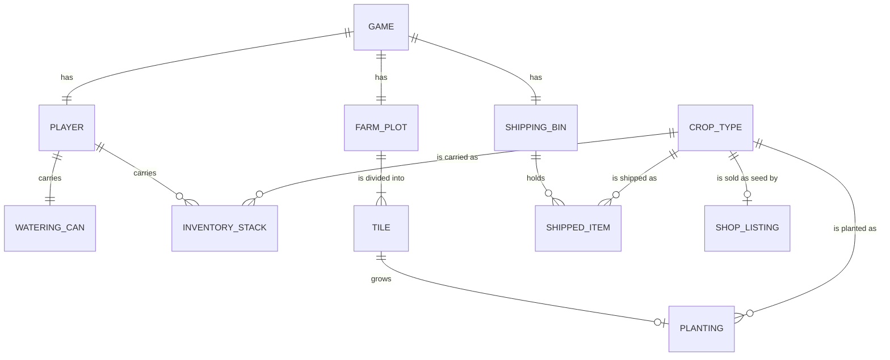
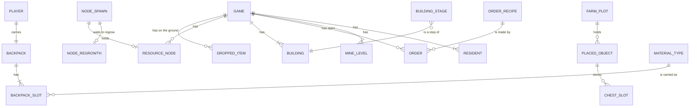
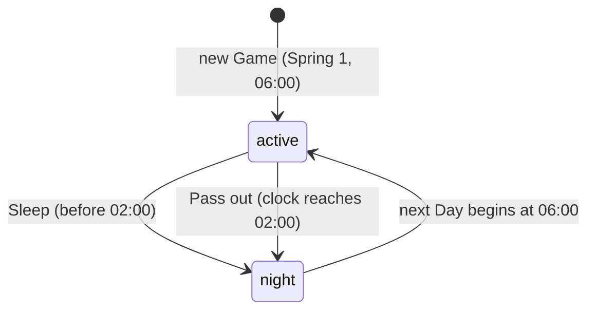
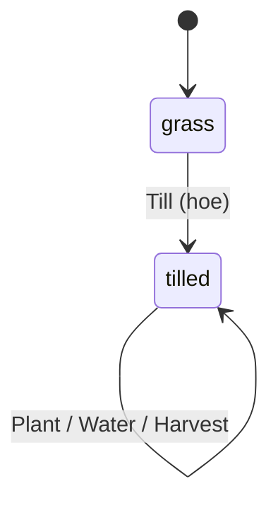
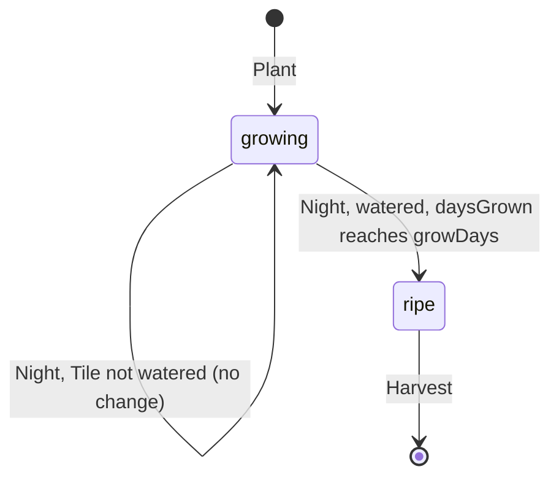
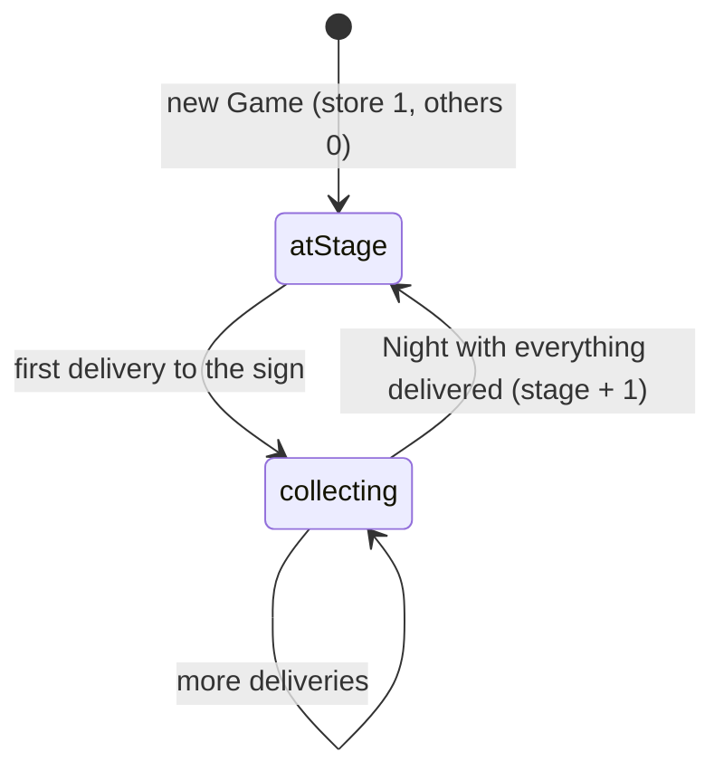
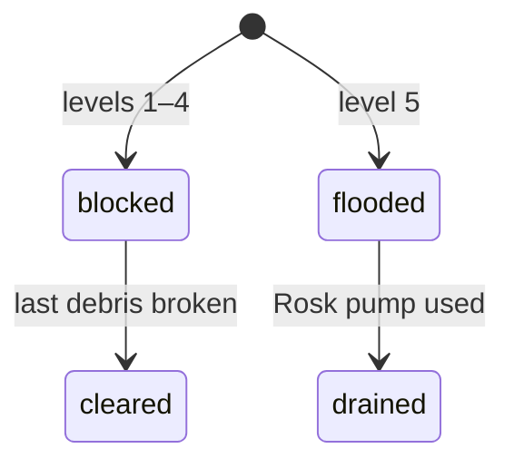
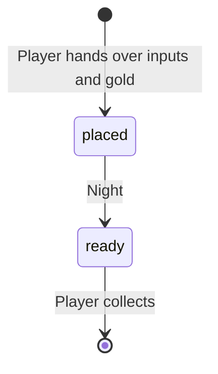
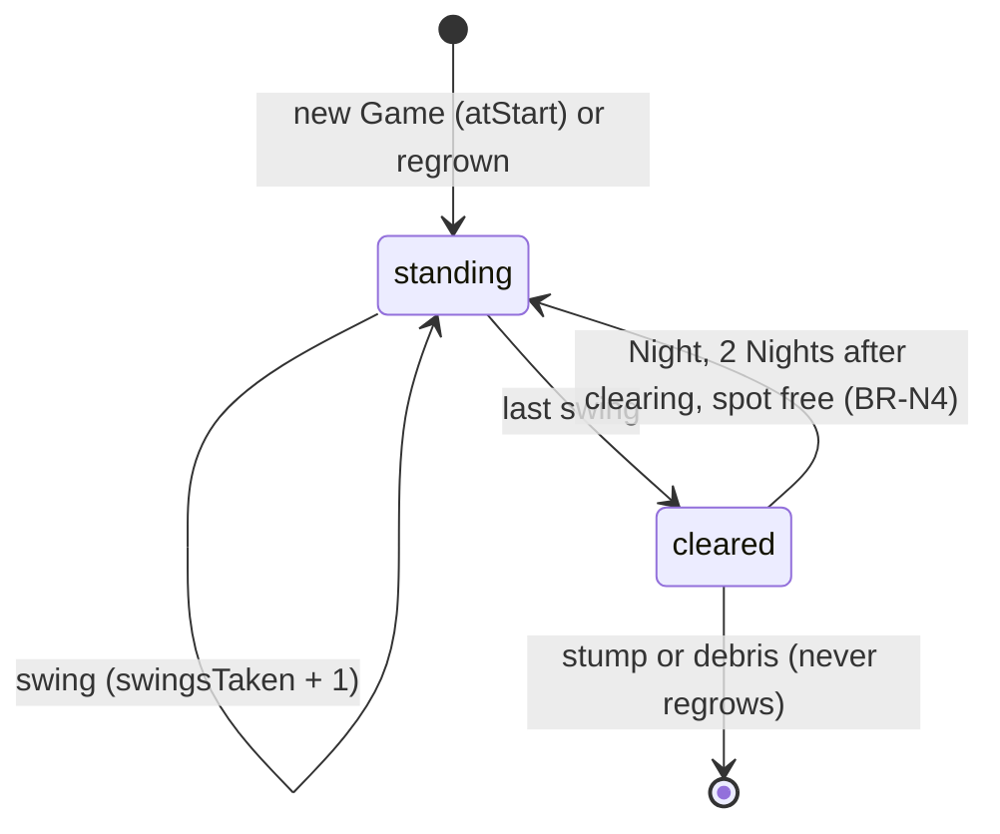

# Long Way Home — Domain Model

Single-context model of the game's rules, derived from [product-definition.md](product-definition.md) and the [requirements log](requirements-log.md). Enumerated values are listed in [canonical-values.md](canonical-values.md). Tuning numbers come from the [Game Design Doc](../GAME_DESIGN.md) data tables.

**Scope.** This version covers **Phase 1 — Godot rebuild** (REQ-1 to REQ-14, REQ-42; built) and **Phase 2 — Rebuilding Ember Bay** (REQ-16, REQ-17, REQ-44, REQ-45, REQ-47 to REQ-51, REQ-57, REQ-58; readied 2026-11-07, not built). Every Phase 2 addition is marked *(planned, REQ-N)*; where a Phase 2 rule changes a Phase 1 one, the rule is rewritten in place and marked *(changed 2026-11-07, REQ-N)*. Later phases add their entities through `requirements-intake` when each phase is readied.

## Ubiquitous Language

| Term | Definition |
|------|------------|
| **Game** | One saved playthrough: the calendar, the clock, the weather and everything the Player owns. A player can hold several Games (save slots). |
| **Player** | The stranded traveller the person controls. Has gold, energy, a watering can and an inventory. |
| **Day** | One in-game day, from 06:00 to 02:00 the next morning, lasting about 12 real minutes. |
| **Clock** | The time of day within the current Day, counted in game minutes since midnight. |
| **Season** | One of spring, summer, fall, winter. Each lasts 28 Days. |
| **Year** | Four Seasons. Year 1 begins on Spring 1. |
| **Night** | The step between two Days when crops grow, the Shipping Bin pays out, the weather is rolled and the Game saves. Not playable time. |
| **Sleep** | Ending the Day at the house door, before 02:00. |
| **Pass out** | Ending the Day by still being awake at 02:00. Costs half the next Day's energy and nothing else. |
| **Energy** | The Player's daily budget for tool actions. 150 at the start of a Day. |
| **Tool action** | One swing of the hoe, axe or pickaxe, or one pour of the watering can. Costs 2 energy at every Tool tier. |
| **Farm plot** | The grid of Tiles the Player farms: 12 x 9 in Phase 1, the 72 x 36 meadow in Phase 2 (REQ-16). |
| **Tile** | One square of the Farm plot. Either grass or tilled. |
| **Till** | Turn a grass Tile into a tilled Tile with the hoe. |
| **Watered** | A tilled Tile that has been watered (or rained on) today. Resets each Night. |
| **Crop type** | A kind of crop, e.g. emberroot. Reference data: grow time, seed cost, sell price, season. |
| **Seed** | An inventory item that can be planted to start a Planting of its Crop type. |
| **Planting** | A crop growing on one Tile: its Crop type and how many days it has grown. |
| **Ripe** | A Planting that has grown its Crop type's full grow time and can be harvested. |
| **Harvest** | Pick a Ripe Planting. One crop goes into the inventory and the Tile stays tilled. |
| **Crop** | A harvested item of a Crop type, sellable through the Shipping Bin. |
| **Inventory** | What the Player carries: Seeds and Crops in stacks per Crop type, plus their tools. No size limit in Phase 1; replaced by the Backpack in Phase 2 (REQ-47). |
| **Watering can** | The Player's can. Holds a number of charges; one charge waters one Tile. |
| **Charge** | One Tile's worth of water in the Watering can. |
| **Pond** | The farm's Water source. Refilling is free. |
| **Rain** | Weather on a Day that waters every tilled Tile for that whole Day. 22% chance each Day. |
| **Shipping Bin** | Where the Player drops all their Crops. Everything in it sells at base price during the Night. Final once dropped. |
| **Shop** | The menu where the Player buys Seeds for the current Season and the Watering can upgrade. In Phase 2, Maggie's general store and the carpenter's and blacksmith's counters (REQ-58). |
| **Can upgrade** | Phase 1 only: a one-time purchase that raises the Watering can's capacity from 20 to 40. Retired in Phase 2; capacity comes from the can's Tool tier (REQ-57). |
| **Gold** | The Player's money. Never negative. |
| **Backpack** | What the Player carries in Phase 2: 12, 24 or 36 Slots. Replaces the unlimited Phase 1 Inventory. |
| **Slot** | One place in the Backpack or a Chest, holding 1 to 99 of one item, or exactly one tool. |
| **Hotbar row** | The 6-Slot row of the Backpack shown on screen. The Player cycles which row it is. |
| **Material** | *(planned, REQ-44)* A gathered or made item used for rebuilds, orders and pumps: wood, sap, stone, Rosk ore, Groth ore, glimmercap, plank, sealed plank, Rosk pump. |
| **Resource node** | *(planned, REQ-44)* A tree, stump, rock, ore deposit, glimmercap or debris pile the Player breaks with the axe or pickaxe for materials. |
| **Spawn point** | *(planned, REQ-44)* A fixed place in an Area where a tree, rock, deposit or glimmercap grows back after it is cleared. |
| **Area** | *(planned, REQ-49)* A part of the world the Player walks in: the farm (the meadow), the forest path, the town, the lakeshore, across the river, and the mine. |
| **Building** | *(planned, REQ-45)* A town building the Player restores stage by stage: the general store, the carpenter, Mira's house and the blacksmith. |
| **Stage** | *(planned, REQ-45)* One step of a Building's restoration. Each has a cost and unlocks goods, services or Residents. |
| **Rebuild sign** | *(planned, REQ-45)* The sign in front of a Building where the Player delivers the next Stage's materials and gold. |
| **Order** | *(planned, REQ-48, REQ-57)* Work the Player leaves with Tom or Mira (planks, sealed planks, a tool upgrade, a pump), ready the next morning. |
| **Tool tier** | How strong a tool is: Basic, Rosk or Groth in Phase 2. |
| **Pump** | *(planned, REQ-49, REQ-57)* A Rosk pump forged by Mira; using one drains a flooded Mine level. |
| **Mine level** | *(planned, REQ-49)* One floor of the old mine, 1 to 5 in Phase 2. Blocked by debris, or flooded. |
| **Resident** | *(planned, REQ-50)* A townsperson living in Ember Bay: Maggie, Clyde, Tom, June, Jesse, Mira. |
| **Placed object** | *(planned, REQ-48)* A fence or chest the Player has set down on the farm. |
| **Water source** | Where the Watering can is refilled: the pond, the river or the lake. |
| **Opening** | *(planned, REQ-17)* Maggie's guided start on Spring 1 of a new Game. |

## Value Objects

| Value Object | Allowed values / shape | Used by |
|--------------|------------------------|---------|
| `Season` | `spring`, `summer`, `fall`, `winter` | Game, CropType |
| `Weather` | `clear`, `rain` | Game |
| `TileState` | `grass`, `tilled` | Tile |
| `PlantingStatus` (derived, never stored) | `growing`, `ripe` | Planting |
| `DayEndReason` | `slept`, `passed_out` | Game (last Night) |
| `ItemKind` | `seed`, `crop`, `tool`; *(planned, REQ-47)* `material`, `placeable` | InventoryStack, BackpackSlot |
| `ToolId` | `hoe`, `watering_can`; *(planned, REQ-58)* `axe`, `pickaxe` | Player tools, ToolItem, Order |
| `ShopItemKind` | `seed`, `can_upgrade` (Phase 1 only); *(planned, REQ-58, REQ-48)* `tool`, `backpack_upgrade`, `placeable`, `farmhouse_upgrade` | ShopListing |
| `CropTypeId` | `emberroot`, `dusktuber`, `moonmelon`, `sunbell`, `starcorn` | CropType, Planting, InventoryStack, ShippedItem, ShopListing |
| `GridPosition` | `{ x: 0–11, y: 0–8 }`; *(planned, REQ-16)* `{ x: 0–71, y: 0–35 }` on the farm, and within each Area's own grid | Tile, ResourceNode, DroppedItem, PlacedObject |
| `GameDate` | `{ year: int ≥ 1, season: Season, day: 1–28 }` | Game |
| `ClockMinutes` | integer, 360 (06:00) to 1560 (02:00 next morning) | Game |
| `Gold` | integer ≥ 0 | Player, CropType, ShopListing, BuildingStage, Order |
| `ToolTier` | `basic`, `rosk`, `groth` | ToolItem, Order |
| `MaterialId` | *(planned, REQ-44)* `wood`, `sap`, `stone`, `rosk_ore`, `groth_ore`, `glimmercap`, `plank`, `sealed_plank`, `rosk_pump` | BackpackSlot, BuildingStage, Order |
| `PlaceableId` | *(planned, REQ-48)* `fence`, `chest` | PlacedObject, BackpackSlot, ShopListing |
| `ItemRef` | `{ kind: ItemKind, id: CropTypeId \| MaterialId \| ToolId \| PlaceableId }` | BackpackSlot, DroppedItem, ChestSlot |
| `NodeKind` | *(planned, REQ-44, REQ-49)* `tree`, `stump`, `rock`, `rosk_deposit`, `groth_deposit`, `glimmercap`, `debris` | ResourceNode, NodeSpawn |
| `AreaId` | `farm`, `forest_path`, `town`, `lakeshore`, `across_river`, `mine` | ResourceNode, DroppedItem, NodeSpawn |
| `BuildingId` | *(planned, REQ-45)* `general_store`, `carpenter`, `miras_house`, `blacksmith` | Building, BuildingStage |
| `OrderKind` | *(planned, REQ-48, REQ-57)* `plank`, `sealed_plank`, `tool_upgrade`, `rosk_pump` | Order |
| `Provider` | *(planned, REQ-48, REQ-57)* `carpenter`, `blacksmith` | Order |
| `MineLevelState` | *(planned, REQ-49)* `blocked`, `cleared`, `flooded`, `drained` | MineLevel |
| `ResidentId` | *(planned, REQ-50)* `maggie`, `clyde`, `tom`, `june`, `jesse`, `mira` | Resident |
| `WaterSource` | `pond`, `river`, `lake` | Refill action |

## Entities & Aggregates

### CropType (reference data)

Loaded from the crop data table; read-only during play. The same for every Game.

| Attribute | Type | Notes |
|-----------|------|-------|
| `id` | CropTypeId | Key. Stable across saves and the prototype name mapping (carrot → emberroot, potato → dusktuber, pumpkin → moonmelon). |
| `name` | string | Display name, e.g. "Emberroot". |
| `growDays` | int | Watered Nights needed to become Ripe. emberroot 3, dusktuber 5, moonmelon 8, sunbell 4, starcorn 7. |
| `seedCost` | Gold | Shop price of one Seed. 15 / 30 / 60 / 20 / 45. |
| `sellPrice` | Gold | Shipping Bin price of one Crop. 35 / 75 / 190 / 50 / 130. |
| `season` | Season | The only Season the Seed can be planted or bought in. spring / spring / fall / summer / summer. |
| `regrows` | bool | `false` for every Phase 1 crop. Kept for later crops. |

Sunbell and starcorn (summer; draft numbers, tuned in playtesting).

### ShopListing (reference data)

The items the Shop can offer. Read-only during play.

| Attribute | Type | Notes |
|-----------|------|-------|
| `id` | string | Key, e.g. `seed_emberroot`, `can_upgrade`. |
| `kind` | ShopItemKind | `seed` or `can_upgrade`. |
| `cropTypeId` | CropTypeId? | FK -> CropType.id. Required when `kind = seed`, otherwise empty. |
| `price` | Gold | For seeds, equals the CropType's `seedCost` (copied so the Shop has one price column). Can upgrade: 200, set in `shop.json` (the upgraded capacity, 40, is in tuning). |

### Game (aggregate root)

One per save slot. Owns the calendar, the clock and the day's weather, and is the consistency boundary for everything below it.

| Attribute | Type | Notes |
|-----------|------|-------|
| `id` | uuid | Surrogate key; one per save slot. |
| `date` | GameDate | Starts at Year 1, Spring 1. |
| `clock` | ClockMinutes | Starts each Day at 360 (06:00). |
| `weather` | Weather | Rolled during the Night for the Day ahead; fixed for that Day. |
| `lastDayEnd` | DayEndReason? | How the previous Day ended. Empty on a new Game. Sets the morning's energy. |
| `createdAt` | instant | Real-world time the Game was started. |
| `savedAt` | instant | Real-world time of the last save (the last Night). |

#### Player (child of Game, exactly one)

| Attribute | Type | Notes |
|-----------|------|-------|
| `gameId` | uuid | FK -> Game.id. |
| `gold` | Gold | Starts at 100. |
| `energy` | int | 0–150. Starts at 150. |
| `tools` | set of ToolId | `hoe` and `watering_can` from the start. Tools are not inventory stacks. |

#### WateringCan (child of Player, exactly one)

| Attribute | Type | Notes |
|-----------|------|-------|
| `capacity` | int | 20, or 40 after the Can upgrade. |
| `charges` | int | 0 to `capacity`. Starts full. |
| `upgraded` | bool | `true` once the Can upgrade is bought. |

#### InventoryStack (child of Player, zero or more)

| Attribute | Type | Notes |
|-----------|------|-------|
| `kind` | ItemKind | `seed` or `crop`. |
| `cropTypeId` | CropTypeId | FK -> CropType.id. |
| `quantity` | int | ≥ 1. A stack at 0 is removed. |

Key: (`kind`, `cropTypeId`). New Game: `seed/emberroot × 10`, `seed/dusktuber × 5`.

#### FarmPlot (child of Game, exactly one)

| Attribute | Type | Notes |
|-----------|------|-------|
| `gameId` | uuid | FK -> Game.id. |
| `width` | int | 12. |
| `height` | int | 9. |

#### Tile (child of FarmPlot, exactly 108)

| Attribute | Type | Notes |
|-----------|------|-------|
| `position` | GridPosition | Key within the FarmPlot. |
| `state` | TileState | Starts `grass`. |
| `watered` | bool | True when watered or rained on today. Always false on grass. Reset each Night. |
| `planting` | Planting? | At most one. Only on a tilled Tile. |

#### Planting (child of Tile, zero or one)

| Attribute | Type | Notes |
|-----------|------|-------|
| `cropTypeId` | CropTypeId | FK -> CropType.id. |
| `plantedOn` | GameDate | Date it was planted. For display and tests only. |
| `daysGrown` | int | 0 to the CropType's `growDays`. Rises by one per watered Night. |
| `status` | PlantingStatus | **Derived, never stored**: `ripe` when `daysGrown = growDays`, otherwise `growing`. |

#### ShippingBin (child of Game, exactly one)

| Attribute | Type | Notes |
|-----------|------|-------|
| `gameId` | uuid | FK -> Game.id. |
| `items` | list of ShippedItem | Emptied every Night. |

ShippedItem: `cropTypeId` (CropTypeId, FK -> CropType.id), `quantity` (int ≥ 1).

### Phase 2 reference data *(planned)*

Loaded from data files like the crop table; read-only during play. Costs, yields and prices are tuning numbers from the Game Design Doc and may change without a rule change.

#### MaterialType *(planned, REQ-44)*

| Attribute | Type | Notes |
|-----------|------|-------|
| `id` | MaterialId | Key. |
| `name` | string | Display name, e.g. "Sealed plank". |
| `maxStack` | int | 99 for every material. |

#### NodeSpawn *(planned, REQ-44, REQ-16, REQ-49)*

The fixed places where Resource nodes start and grow back. The same in every Game.

| Attribute | Type | Notes |
|-----------|------|-------|
| `id` | string | Key. |
| `area` | AreaId | Where it is. |
| `mineLevel` | int? | 1–5 when `area = mine`, otherwise empty. |
| `position` | GridPosition | Within the Area's grid (the mine level's grid in the mine). |
| `kind` | NodeKind | What grows here. |
| `atStart` | bool | Whether a node stands here in a new Game. On the farm, every spawn point inside the cleared 6 x 6 is `false`. |
| `respawns` | bool | `true` for `tree`, `rock`, `rosk_deposit`, `groth_deposit`, `glimmercap`; `false` for `stump` and `debris` (BR-N5). |

NodeKind yields (tuning, Basic tier): tree 5 wood + 2 sap; rock 3 stone; rosk_deposit Rosk ore; groth_deposit Groth ore (mine levels 3–5 only); glimmercap 1 glimmercap (picked by hand, no tool); stump wood (Groth axe); debris stone.

#### BuildingStage *(planned, REQ-45)*

| Attribute | Type | Notes |
|-----------|------|-------|
| `buildingId` | BuildingId | FK -> Building. |
| `stage` | int | The stage this cost reaches, 1 up to the Building's last Phase 2 stage. |
| `costItems` | list of `{ item: MaterialId, quantity: int ≥ 1 }` | E.g. store stage 2: 50 wood, 25 stone. |
| `costGold` | Gold | E.g. store stage 2: 300. |
| `requires` | condition? | Extra condition before its sign appears (BR-B4). Only blacksmith stage 1: Mira is present. |
| `unlocks` | text and listing ids | What the stage opens (BR-B5). |

Phase 2 stages: general_store 1 (start) to 4; carpenter 0 (ruined at start) to 2; miras_house 0 to 1; blacksmith 0 to 2.

#### ShopListing additions *(planned, REQ-58, REQ-48)*

`ShopListing` gains `vendor` (`general_store` or `carpenter`), `requiresStage` (int, the vendor Building's stage that offers it), `toolId` (ToolId?), `placeableId` (PlaceableId?), `backpackCapacity` (int?) and `oncePerGame` (bool). Phase 2 listings: in-season seeds (store, stage 1); axe 50 and pickaxe 75 (store, stage 1, once); backpack 24 (store, stage 2, once) and 36 (store, stage 3, once); chest (store stage 3, and carpenter stage 1); fence (carpenter stage 1); farmhouse upgrade (carpenter stage 2, once). The `can_upgrade` listing is removed (BR-L1).

#### OrderRecipe *(planned, REQ-48, REQ-57)*

| Attribute | Type | Notes |
|-----------|------|-------|
| `kind` | OrderKind | Key, with `toTier` for tool upgrades. |
| `provider` | Provider | `carpenter` for planks and sealed planks; `blacksmith` for tool upgrades and pumps. |
| `requiresStage` | int | Provider Building stage: plank, sealed_plank 1; rosk_pump 1; tool_upgrade to rosk 1, to groth 2. |
| `inputs` | list of `{ item: MaterialId, quantity }` | Plank: 2 wood. Sealed plank: 1 plank + 1 sap. Rosk pump: 20 Rosk ore + 30 planks. Tool upgrade: costs to be set. |
| `gold` | Gold | Plank 5, sealed plank 10, Rosk pump 500 (draft). |
| `output` | `{ item, quantity }` | One plank, one sealed plank, one Rosk pump, or the same tool one tier up. |

#### ToolTierEffect *(planned, REQ-57)*

| Tool | Basic | Rosk | Groth |
|------|-------|------|-------|
| hoe | 1 tile | 3 tiles in a row | 3 x 3 area |
| watering_can | capacity 20, 1 tile | capacity 40, 1 tile | capacity 60, 3 tiles in a row |
| axe | 4 swings a tree | 3 swings | 2 swings; clears stumps; more wood |
| pickaxe | 4 swings a rock | 3 swings | 2 swings; more stone |

### Phase 2 changes to Player

- `Player.tools` is replaced by tools held in Backpack Slots as `ToolItem`s. The hoe and watering can are Basic in a new Game (BR-P6).
- *(planned, REQ-57)* `WateringCan.capacity` is derived from the can's tier (20 / 40 / 60); `upgraded` is retired (BR-W1, BR-W4).
- `InventoryStack` is replaced by `BackpackSlot` (BR-P7, BR-K2).

#### Backpack (child of Player, exactly one)

| Attribute | Type | Notes |
|-----------|------|-------|
| `capacity` | int | 12, 24 or 36. Starts at 12. |
| `slots` | list of BackpackSlot | Exactly `capacity` entries, index 0 to capacity − 1. |
| `hotbarRow` | int | 0 to capacity / 6 − 1. Starts at 0. |

BackpackSlot: `index` (int), `item` (ItemRef?, empty when the slot is free), `quantity` (int, 1–99; always 1 for a tool), `toolTier` (ToolTier?, required when the item is a tool).

#### DroppedItem (child of Game, zero or more)

| Attribute | Type | Notes |
|-----------|------|-------|
| `area` | AreaId | Where it fell. |
| `mineLevel` | int? | When dropped in the mine. |
| `position` | GridPosition | At the farmer's feet when it was dropped. |
| `item` | ItemRef | Never a tool (BR-K6). |
| `quantity` | int | 1–99. |

#### ResourceNode (child of Game, zero or more) *(planned, REQ-44, REQ-16, REQ-49)*

| Attribute | Type | Notes |
|-----------|------|-------|
| `spawnId` | string | FK -> NodeSpawn.id. Key: at most one node per spawn point. |
| `kind` | NodeKind | Copied from the spawn point. |
| `swingsTaken` | int | 0 up to the swings needed at the tool's tier. Reset each Night. |

#### NodeRegrowth (child of Game, zero or more) *(planned, REQ-44)*

| Attribute | Type | Notes |
|-----------|------|-------|
| `spawnId` | string | FK -> NodeSpawn.id. A respawning spawn point whose node was cleared. |
| `clearedOn` | GameDate | When it was cleared. Grows back after 2 Nights (tuning), subject to BR-N4. |

#### PlacedObject (child of FarmPlot, zero or more) *(planned, REQ-48)*

| Attribute | Type | Notes |
|-----------|------|-------|
| `position` | GridPosition | Key within the FarmPlot. One object per Tile. |
| `placeable` | PlaceableId | `fence` or `chest`. |
| `slots` | list of ChestSlot | Chest only: 36 slots, same shape as BackpackSlot. |

#### Building (child of Game, one per BuildingId) *(planned, REQ-45)*

| Attribute | Type | Notes |
|-----------|------|-------|
| `id` | BuildingId | Key. |
| `stage` | int | Starts: general_store 1, carpenter 0, miras_house 0, blacksmith 0. |
| `delivered` | list of `{ item: MaterialId, quantity }` plus `gold` | Delivered toward the next stage. Cleared when the stage is rebuilt. |
| `rebuildDue` | bool | **Derived**: `true` when `delivered` covers the next stage's full cost. |

#### Order (child of Game, zero or more) *(planned, REQ-48, REQ-57)*

| Attribute | Type | Notes |
|-----------|------|-------|
| `id` | uuid | Key. |
| `provider` | Provider | Who holds it. |
| `kind` | OrderKind | What it makes. |
| `quantity` | int | ≥ 1; always 1 for a tool upgrade. |
| `tool` | `{ toolId, fromTier }`? | Tool upgrades only. The tool is out of the Backpack while the Order is open. |
| `placedOn` | GameDate | Ready from the next morning. |
| `ready` | bool | Set in the Night after `placedOn`. |

#### MineLevel (child of Game, exactly five) *(planned, REQ-49)*

| Attribute | Type | Notes |
|-----------|------|-------|
| `number` | int | 1–5. Key. |
| `state` | MineLevelState | Levels 1–4 start `blocked`; level 5 starts `flooded`. |
| `reached` | bool | The Player has set foot on it. |

#### Resident (child of Game, one per ResidentId) *(planned, REQ-50)*

| Attribute | Type | Notes |
|-----------|------|-------|
| `id` | ResidentId | Key. |
| `present` | bool | `true` for maggie and clyde from the start; the others arrive by BR-R2 and BR-R3. Never goes back to `false`. |

#### Game additions *(planned, REQ-17, REQ-49, REQ-48)*

| Attribute | Type | Notes |
|-----------|------|-------|
| `openingDone` | bool | `false` in a new Game until Maggie's Opening finishes (BR-I1). |
| `mineOpen` | bool | `true` from the purchase of the pickaxe (BR-M1). |
| `farmhouseRestored` | bool | `true` the morning after the farmhouse upgrade is bought (BR-B5). |

The farm ShippingBin exists only once the general store is at stage 4 (BR-S3).

## Relationships



Phase 2 additions *(planned)*:



## Lifecycle State Machines

### Day

States: `active` → `night` → `active` (next Day). `night` is not playable; it runs the Night steps below in a fixed order. Day phases are not stored; they are listed here for the transition rules.



| Transition | Actor | Rule |
|------------|-------|------|
| new Game → active | Player | BR-G1, BR-P6 |
| active → night (Sleep) | Player, at the house door | BR-G3 |
| active → night (Pass out) | Game, when the clock reaches 02:00 | BR-G3, BR-P4 |
| night → active | Game | Night steps in order: BR-T4 growth → BR-S2 payout → BR-K4 dropped items removed → BR-G1 date advance → BR-G4 weather → BR-T7 watering reset → BR-P3 energy → BR-G5 save |
| night → active (Phase 2) *(planned, REQ-45, REQ-48, REQ-50, REQ-57)* | Game | Night steps in order: BR-T4 growth → BR-S2 payout (once the bin exists, BR-S3) → BR-B3 rebuilds → BR-O2 orders ready → BR-R2, BR-R3 residents arrive → BR-K4 dropped items removed → BR-N4 regrowth → BR-G1 date advance → BR-G4 weather → BR-T7 watering reset → BR-P3 energy → BR-G5 save |

### Tile



A tilled Tile never returns to grass (BR-T8).

| Transition | Actor | Rule |
|------------|-------|------|
| grass → tilled | Player | BR-T2, BR-P2 |
| tilled: plant | Player | BR-T3, BR-C1 |
| tilled: water | Player | BR-W2, BR-P2, BR-T9 |
| tilled: harvest | Player | BR-T6 |

### Planting



| Transition | Actor | Rule |
|------------|-------|------|
| → growing | Player | BR-T3 |
| growing → growing / ripe | Game (Night) | BR-T4, BR-T5 |
| ripe → harvested | Player | BR-T6 |

### Building *(planned, REQ-45)*



| Transition | Actor | Rule |
|------------|-------|------|
| deliver | Player, at the Rebuild sign | BR-B2, BR-B4 |
| rebuild | Game (Night) | BR-B3, BR-B5 |

### MineLevel *(planned, REQ-49)*



| Transition | Actor | Rule |
|------------|-------|------|
| blocked → cleared | Player (pickaxe) | BR-M2 |
| flooded → drained | Player (Rosk pump) | BR-M3, BR-M4 |

### Order *(planned, REQ-48, REQ-57)*



| Transition | Actor | Rule |
|------------|-------|------|
| → placed | Player, at Tom's or Mira's counter | BR-O1, BR-O4 |
| placed → ready | Game (Night) | BR-O2 |
| ready → collected | Player | BR-O3 |

### Resource node *(planned, REQ-44)*



| Transition | Actor | Rule |
|------------|-------|------|
| swing | Player | BR-N1, BR-N2, BR-P2 |
| cleared | Player | BR-N3 |
| regrow | Game (Night) | BR-N4, BR-N5 |

## Business Rules

Abbreviations: **G** Game, **P** Player, **W** WateringCan, **T** FarmPlot and Tile, **C** CropType, **S** ShippingBin, **L** Shop (ShopListing); Phase 2: **K** Backpack, **N** Resource nodes, **F** Placed objects, **B** Buildings, **O** Orders, **U** Tool tiers, **M** Mine, **A** Areas and water, **R** Residents, **I** Opening.

### Game

- BR-G1: The date advances by one day each Night. After day 28 of a Season comes day 1 of the next Season (spring → summer → fall → winter → spring), and after winter the Year rises by one. A new Game starts on Year 1, Spring 1. (REQ-10)
- BR-G2: The clock runs from 06:00 to 02:00 at about 1.67 game minutes per real second, so a full Day takes about 12 real minutes. It advances only while play is running, never while a menu is open. (REQ-3)
- BR-G3: A Day ends exactly once: by Sleep at the house door before 02:00, or by Pass out when the clock reaches 02:00. (REQ-4)
- BR-G4: Each Day's weather is rolled once during the Night before it, with a 22% chance of `rain`, and does not change during the Day. (REQ-7)
- BR-G5: The Game is saved once per Night, after every other Night step. Loading a Game always resumes at 06:00 on the saved Day, with no progress from a Day that was not slept or passed out of. (REQ-11)

### Player

- BR-P1: Energy is always between 0 and 150. (REQ-5)
- BR-P2: Each Tool action (till, water, and from Phase 2 each axe or pickaxe swing) costs 2 energy at every Tool tier and cannot happen with less than 2 energy. Planting, harvesting, picking glimmercaps, refilling the can, shipping, selling, buying, delivering and placing cost no energy. (REQ-5) *(changed 2026-11-07, REQ-44, REQ-57)*
- BR-P3: The Day after a Sleep starts with 150 energy; the Day after a Pass out starts with 75. (REQ-4, REQ-5)
- BR-P4: Passing out changes nothing except the next Day's starting energy: gold, inventory, the Farm plot and the Shipping Bin are the same as after a Sleep. (REQ-4)
- BR-P5: Gold is never negative. (REQ-9)
- BR-P6: A new Game starts with 100 gold, 150 energy, a Basic hoe and a full Basic 20-charge Watering can in the Backpack. Maggie gives the 10 emberroot Seeds and 5 dusktuber Seeds during the Opening. (REQ-2) *(changed 2026-11-07, REQ-17, REQ-47)*
- BR-P7: An inventory stack always has a quantity of at least 1, and there is at most one stack per (kind, Crop type). (REQ-1) *(changed 2026-11-07, REQ-47)*: from Phase 2 the Backpack's Slots replace stacks, and the same item may fill several Slots (BR-K2).

### WateringCan

- BR-W1: Charges are always between 0 and capacity. Capacity comes from the can's Tool tier: 20 Basic, 40 Rosk, 60 Groth. (REQ-6, REQ-9) *(changed 2026-11-07, REQ-57)*
- BR-W2: Watering one Tile uses exactly one charge and cannot happen with 0 charges. (REQ-6)
- BR-W3: Refilling at any open Water source (the farm pond, the river, the lake) sets charges to capacity and costs no energy. (REQ-6) *(changed 2026-11-07, REQ-51)*
- BR-W4: The Can upgrade can be bought once per Game. Buying it sets capacity to 40 and fills the can. (REQ-9) *(changed 2026-11-07, REQ-57: retired; capacity rises only through Tool tiers, BR-U2. A save with the Can upgrade loads with a Rosk can.)*

### FarmPlot and Tile

- BR-T1: The Farm plot has exactly 72 x 36 Tiles (draft size), one per grid position. (REQ-1) *(changed 2026-11-07, REQ-16; Phase 1: 12 x 9)*
- BR-T2: Only a grass Tile with no Resource node or Placed object on it can be tilled. Tilling makes it tilled. (REQ-1) *(changed 2026-11-07, REQ-16, REQ-48)*
- BR-T3: A Seed can be planted only on a tilled Tile with no Planting, in its Crop type's Season, and only if the Player has that Seed. Planting uses one Seed. (REQ-1, REQ-10)
- BR-T4: During the Night, a growing Planting on a watered Tile gains one day of growth. One on a Tile that was not watered does not change. (REQ-1)
- BR-T5: A Planting never dies or disappears. Missing water and changing Season only affect whether it grows, and a Planting keeps growing to Ripe after its Season ends. (REQ-1, REQ-10)
- BR-T6: Only a Ripe Planting can be harvested. Harvesting removes the Planting, adds one Crop of its type to the inventory, and leaves the Tile tilled with its watered state unchanged. (REQ-1)
- BR-T7: Every Tile's watered state is reset to false each Night. On a `rain` Day, every tilled Tile is watered for the whole Day, including Tiles tilled during that Day. (REQ-1, REQ-7)
- BR-T8: A tilled Tile never reverts to grass. (REQ-1)
- BR-T9: Only a tilled Tile that is not already watered can be watered; watering one that is already watered is refused and costs no charge or energy. (REQ-6)

### CropType

- BR-C1: A Crop type's Seeds can be planted only during its `season`. (REQ-10)
- BR-C2: Every Crop type has `growDays` ≥ 1 and a `seedCost` and `sellPrice` above 0. (REQ-1)

### ShippingBin

- BR-S1: Shipping moves every Crop in the inventory into the Shipping Bin at once. Seeds cannot be shipped, and nothing can be taken back out. (REQ-8) *(changed 2026-11-07, REQ-58: applies once the Bin exists, BR-S3; only Crops ship, never materials, tools or placeables)*
- BR-S2: During the Night, the Player's gold rises by the sum of quantity × `sellPrice` for every item in the Shipping Bin, and the Bin is emptied. (REQ-8)
- BR-S3: The farm Shipping Bin exists only once the general store is at stage 4; before that, Crops are sold to Maggie (BR-L3). *(planned, REQ-58)*

### Shop

- BR-L1: The Shop offers Seeds only for Crop types whose `season` is the current Season; in a Season with no such Crop types it offers no Seeds. The Can upgrade is offered until bought. (REQ-9, REQ-10) *(changed 2026-11-07, REQ-58: Maggie's store offers every in-season Seed from stage 1; the Can upgrade is no longer offered)*
- BR-L2: A purchase happens only if the Player's gold is at least the price. It takes the price in gold and adds the item in the same step. (REQ-9)
- BR-L3: Maggie buys Crops at the general store for their `sellPrice` and pays at once. Seeds, materials, tools and placeables can't be sold. *(planned, REQ-58)*
- BR-L4: The axe and pickaxe are sold at Maggie's store from stage 1, once each per Game. Each joins the Backpack at Basic tier; a purchase that finds no free Slot is refused and costs nothing. *(planned, REQ-58)*
- BR-L5: A listing is offered only when its vendor Building is at or above its `requiresStage`, and a `oncePerGame` listing only until bought. Buying a backpack upgrade sets the Backpack's capacity to that size and adds empty Slots. *(planned, REQ-58, REQ-47)*

### Backpack

- BR-K1: The Backpack has 12, 24 or 36 Slots, and its capacity never goes down.
- BR-K2: A Slot is empty or holds 1 to 99 of one item. A tool is always alone in its Slot, with its tier. The same item may fill several Slots.
- BR-K3: An item the Player gains goes first onto a Slot of the same item below 99, then into the lowest free Slot. What fits nowhere drops at the farmer's feet as a DroppedItem.
- BR-K4: A DroppedItem can be picked up again while there is room; every DroppedItem left is removed in the Night.
- BR-K5: The hotbar is the 6 Slots of `hotbarRow`. Cycling moves to the next row and wraps back to row 0.
- BR-K6: Tools can't be dropped, sold, shipped, stored in a chest or lost; they leave the Backpack only while an upgrade Order holds them (BR-O4). *(planned, REQ-57: the upgrade Order)*

### Resource nodes *(planned, REQ-44, REQ-16, REQ-49)*

- BR-N1: The axe works on trees and stumps; the pickaxe on rocks, ore deposits and debris. Glimmercaps are picked by hand. A swing on any other node does nothing and costs nothing. *(planned, REQ-44, REQ-49)*
- BR-N2: Each swing costs 2 energy (BR-P2). A node is cleared on the swing that reaches its tier's count: Basic 4, Rosk 3, Groth 2. Swings taken on a node not cleared are forgotten in the Night. *(planned, REQ-44, REQ-57)*
- BR-N3: Clearing a node gives its yield (NodeSpawn yields, tier bonus by tuning) through BR-K3 and frees its Tile. *(planned, REQ-44)*
- BR-N4: In the Night, a respawning spawn point whose node was cleared at least 2 Nights before (tuning) grows its node back, unless its Tile is tilled, holds a Placed object, or is within 3 tiles of a tilled Tile. A blocked spawn point keeps waiting. *(planned, REQ-44)*
- BR-N5: Stumps and debris never grow back. *(planned, REQ-16, REQ-49)*
- BR-N6: A stump can be cleared only with a Groth axe. *(planned, REQ-16, REQ-57)*
- BR-N7: A new Game places a node at every `atStart` spawn point. The farm's cleared 6 x 6 by the farmhouse has none. *(planned, REQ-16)*

### Placed objects *(planned, REQ-48)*

- BR-F1: A fence or chest can be placed only on a farm Tile that is not tilled and has no node, Placed object or Planting. Placing moves it out of the Backpack. *(planned, REQ-48)*
- BR-F2: A fence, or a chest with every Slot empty, can be picked back up into a free Slot. A chest's 36 Slots follow BR-K2, without tools. *(planned, REQ-48)*

### Buildings *(planned, REQ-45)*

- BR-B1: A Building rises one stage at a time, in order, to its last Phase 2 stage. *(planned, REQ-45)*
- BR-B2: At a Building's Rebuild sign the Player can deliver any amount of the next stage's items and gold, up to what is still needed. A delivery takes the items from the Backpack and the gold at once, and can't be taken back. *(planned, REQ-45)*
- BR-B3: In the Night after the next stage's full cost has been delivered, the Building's stage rises by one and its deliveries are cleared. *(planned, REQ-45)*
- BR-B4: A Rebuild sign appears only for a Building whose next stage exists and whose `requires` holds: the blacksmith's needs Mira present (BR-R3). The carpenter's and Mira's house's signs are there from the start. *(planned, REQ-45, REQ-50)*
- BR-B5: Stage unlocks: general store 2 the 24-slot backpack, 3 the 36-slot backpack and chests, 4 the farm Shipping Bin (BR-S3); carpenter 1 planks, sealed planks, fences and chests and the Hollis family, 2 the bridge (BR-A1) and the farmhouse upgrade; Mira's house 1 Mira's return (BR-R3); blacksmith 1 Rosk upgrades and Rosk pumps, 2 Groth upgrades. The farmhouse upgrade, once bought, sets `farmhouseRestored` the next morning and changes only the farmhouse's look. *(planned, REQ-45, REQ-48, REQ-57, REQ-58)*

### Orders *(planned, REQ-48, REQ-57)*

- BR-O1: The Player places an Order at the carpenter or the blacksmith when the provider's stage offers that recipe and the Player has the inputs and gold for the quantity. Both are taken at once. *(planned, REQ-48, REQ-57)*
- BR-O2: Every Order placed during a Day is ready in the Night that follows. *(planned, REQ-48, REQ-57)*
- BR-O3: A ready Order waits at its provider until collected; collecting adds its output through BR-K3 and needs room for a tool. Nothing about a ready Order expires. *(planned, REQ-48, REQ-57)*
- BR-O4: A tool upgrade Order takes the tool out of the Backpack and returns it one tier up. At most one Order per tool at a time. Rosk needs blacksmith stage 1; Groth needs stage 2 and a Rosk tool. *(planned, REQ-57)*

### Tool tiers *(planned, REQ-57)*

- BR-U1: Every tool action costs 2 energy at every tier (BR-P2). *(planned, REQ-57)*
- BR-U2: A tool's tier sets what one action does (ToolTierEffect). A hoe or can action covers the Tiles in its shape in front of the farmer and affects only the Tiles it can (BR-T2, BR-T9); a can action uses one charge per Tile watered and waters as many as its charges allow. An action that affects no Tile is refused and costs nothing. *(planned, REQ-57)*
- BR-U3: Tiers only go up: Basic → Rosk → Groth in Phase 2. *(planned, REQ-57)*

### Mine *(planned, REQ-49)*

- BR-M1: The mine opens when the pickaxe is bought, and Maggie tells the mine's story once, then. *(planned, REQ-49)*
- BR-M2: Levels 1–4 start `blocked` by debris. A level becomes `cleared` when its last debris is broken, and its staircase to the next level opens. A cleared level stays cleared. *(planned, REQ-49)*
- BR-M3: Level 5 starts `flooded`. Using a Rosk pump there drains it: the pump is used up and the level is `drained` for good. *(planned, REQ-49, REQ-57)*
- BR-M4: The staircase connects each level to the next once the level above is cleared. Every fifth level, once cleared or drained, adds a shortcut from the entrance to it. *(planned, REQ-49)*
- BR-M5: Mine levels hold rocks, Rosk ore deposits and glimmercaps; levels 3–5 also hold a few small Groth deposits. These grow back by BR-N4; debris doesn't (BR-N5). *(planned, REQ-49)*
- BR-M6: Setting foot on a level marks it `reached`. The mine has no danger; passing out there ends the Day as anywhere else (BR-G3, BR-P4) and the next Day starts at the farmhouse. *(planned, REQ-49, REQ-50)*

### Areas and water *(planned, REQ-48, REQ-49)*

- BR-A1: The farm, forest path, town and lakeshore are open from the start; the mine from BR-M1; across the river once the carpenter is at stage 2. An Area never closes again. Built for the four start areas (#136: `Game.IsAreaOpen`, `GameSession.EnterArea`); the mine and across the river stay closed until BR-M1 and the carpenter's stage 2 are built. *(planned for the mine and across the river, REQ-48, REQ-49)*
- BR-A2: The pond is on the farm, the river runs along the meadow and through town, and the lake is at the lakeshore. Each is a Water source for BR-W3.

### Residents *(planned, REQ-50)*

- BR-R1: Maggie and Clyde are present from the start. A Resident who arrives never leaves. *(planned, REQ-50)*
- BR-R2: Tom, June and Jesse arrive in the Night the carpenter reaches stage 1. *(planned, REQ-50)*
- BR-R3: Mira arrives in the first Night when Mira's house is at stage 1 and mine level 5 is `reached`, in either order; she then asks the Player to rebuild the blacksmith. *(planned, REQ-50)*

### Opening *(planned, REQ-17)*

- BR-I1: The Opening plays once, in a new Game on Spring 1, and sets `openingDone` when it ends. The clock doesn't run while Maggie is talking (BR-G2). Her lines can be skipped; the till, plant and water steps can't. A Game that loads with `openingDone` never replays it. *(planned, REQ-17)*

## Data Retention Strategy

| Data | Retention |
|------|-----------|
| Game (with Player, WateringCan, InventoryStacks, FarmPlot, Tiles, Plantings, ShippingBin) | Kept in the save slot on the player's machine until the player deletes or overwrites that slot. Overwritten in place each Night. |
| CropType, ShopListing | Reference data shipped with the game build, not part of a save. A save stores only `CropTypeId` values, so later builds can retune prices without breaking saves. |
| Past Days | Not kept. Only the current state is saved; there is no history of earlier Days. |
| Phase 2 Game state (Backpack, DroppedItems, ResourceNodes, NodeRegrowths, PlacedObjects, Buildings, Orders, MineLevels, Residents, Game flags) *(planned, REQ-45 to REQ-50)* | Part of the Game in its save slot, overwritten each Night like the rest. DroppedItems never outlive a Night (BR-K4), so a save never holds one. |
| MaterialType, NodeSpawn, BuildingStage, OrderRecipe, ToolTierEffect *(planned)* | Reference data shipped with the build. A save stores only ids, positions and counts, so costs and yields can be retuned without breaking saves. |

Each save file carries a save-format version (`saveVersion`, currently 2), so later phases (backpack slots, buildings) can migrate Phase 1 saves.

Phase 2 saves are version 2. A version 1 save loads with: its stacks packed into Backpack Slots (raising capacity to 24 or 36 only if they don't fit in 12); the hoe and can at Basic, or the can at Rosk if the Can upgrade was bought; *(planned, REQ-47)* its 12 x 9 Tiles inside the farm's cleared start region with no nodes on them; `openingDone` true; every other Phase 2 state as in a new Game, so the general store is at stage 1 and the farm Bin is gone until stage 4 (BR-S3); anything in the Bin at save time was already paid out in that Night.

Future: Steam Cloud sync of save slots.

## Example Payloads

New Game (state after creation):

```json
{
  "id": "4f1c2a9e-7b3d-4c55-9a10-2e8f6d1b7c30",
  "date": { "year": 1, "season": "spring", "day": 1 },
  "clock": 360,
  "weather": "clear",
  "lastDayEnd": null,
  "createdAt": "2026-11-06T19:42:10Z",
  "savedAt": "2026-11-06T19:42:10Z",
  "player": {
    "gold": 100,
    "energy": 150,
    "tools": ["hoe", "watering_can"],
    "wateringCan": { "capacity": 20, "charges": 20, "upgraded": false },
    "inventory": [
      { "kind": "seed", "cropTypeId": "emberroot", "quantity": 10 },
      { "kind": "seed", "cropTypeId": "dusktuber", "quantity": 5 }
    ]
  },
  "farmPlot": { "width": 12, "height": 9, "tiles": [ { "position": { "x": 0, "y": 0 }, "state": "grass", "watered": false, "planting": null } ] },
  "shippingBin": { "items": [] }
}
```

Plant a Seed (Tile after the action):

```json
{
  "action": "plant",
  "position": { "x": 3, "y": 2 },
  "cropTypeId": "emberroot",
  "result": {
    "position": { "x": 3, "y": 2 },
    "state": "tilled",
    "watered": false,
    "planting": { "cropTypeId": "emberroot", "plantedOn": { "year": 1, "season": "spring", "day": 1 }, "daysGrown": 0 }
  }
}
```

Water a Tile:

```json
{
  "action": "water",
  "position": { "x": 3, "y": 2 },
  "result": { "energy": 146, "wateringCan": { "capacity": 20, "charges": 19, "upgraded": false }, "tile": { "position": { "x": 3, "y": 2 }, "watered": true } }
}
```

Harvest a Ripe Planting:

```json
{
  "action": "harvest",
  "position": { "x": 3, "y": 2 },
  "result": {
    "tile": { "position": { "x": 3, "y": 2 }, "state": "tilled", "watered": true, "planting": null },
    "inventoryChange": { "kind": "crop", "cropTypeId": "emberroot", "quantity": 1 }
  }
}
```

Ship and buy:

```json
{ "action": "ship", "shipped": [ { "cropTypeId": "emberroot", "quantity": 9 } ], "pendingPayout": 315 }
```

```json
{ "action": "buy", "shopListingId": "seed_dusktuber", "quantity": 4, "goldBefore": 415, "goldAfter": 295 }
```

End of Day (Pass out) and the Night that follows:

```json
{
  "dayEnd": "passed_out",
  "night": {
    "plantingsGrown": 14,
    "payout": 315,
    "newDate": { "year": 1, "season": "spring", "day": 5 },
    "weather": "rain",
    "energy": 75,
    "savedAt": "2026-11-06T20:31:02Z"
  }
}
```

Deliver to a Rebuild sign *(planned, REQ-45)*:

```json
{
  "action": "deliver",
  "buildingId": "general_store",
  "nextStage": 2,
  "delivered": [ { "item": "wood", "quantity": 30 }, { "item": "stone", "quantity": 25 } ],
  "gold": 300,
  "result": { "stillNeeded": [ { "item": "wood", "quantity": 20 } ], "rebuildDue": false }
}
```

Place a plank Order at the carpenter *(planned, REQ-48)*:

```json
{
  "action": "order",
  "provider": "carpenter",
  "kind": "plank",
  "quantity": 10,
  "taken": { "items": [ { "item": "wood", "quantity": 20 } ], "gold": 50 },
  "result": { "id": "b2e4c7a1-0d5f-4e8b-9c3a-6f1d2e7b8a90", "placedOn": { "year": 1, "season": "spring", "day": 9 }, "ready": false }
}
```

Chop a tree with a full Backpack *(planned, REQ-44, REQ-47)*:

```json
{
  "action": "swing",
  "tool": { "toolId": "axe", "tier": "basic" },
  "spawnId": "farm_tree_041",
  "result": {
    "energy": 118,
    "cleared": true,
    "added": [ { "item": { "kind": "material", "id": "wood" }, "quantity": 5 } ],
    "dropped": [ { "area": "farm", "position": { "x": 14, "y": 9 }, "item": { "kind": "material", "id": "sap" }, "quantity": 2 } ]
  }
}
```
